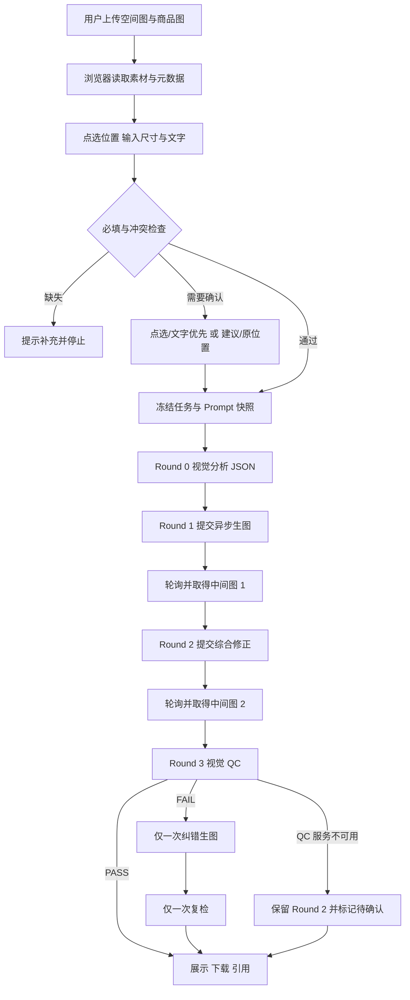

# 多轮生图项目复盘与通用实施指南

> 面向对象：后续接手本项目的 AI、工程师、产品经理和测试人员  
> 当前实例：栖境 AI 家居空间预览，冻结基线 `V2_test`  
> 文档目的：记录这次从“前端拼贴式效果图”演进到“浏览器编排的多阶段场景编辑”的完整过程，并把其中可复用的方法提炼成其他 AI 媒体生成项目也能采用的工作方式。  
> 重要说明：本文描述的是当前代码中真实存在的实现和本次测试中得到的经验，不等同于生产级最佳实践。文中“建议”“后续”均表示尚未完成。

## 1. 先理解问题：我们真正要解决的不是“多生成几张图”

最初的问题看起来是家具没有摆好，但根本矛盾是生成路线不对：系统把商品主体抠出后叠到房间照片上，结果具有明显的二维拼贴感。家具的大小、透视、接地、遮挡、阴影和房间光线都没有被重新计算。

产品真正需要的是场景理解式图像编辑：

1. 房间照片是主要编辑对象，而不是背景画布。
2. 商品图是外观参考，而不是直接贴到房间上的图层。
3. 模型应重新生成局部场景，让家具自然进入空间。
4. 未编辑区域应尽量保留，不能顺便重做整个房间。
5. 生成结果要能继续引用、再次编辑、下载和追踪。

这意味着“多轮生图”的价值不是重复调用模型，而是把不同目标拆开：先完成物体与位置，再集中修正空间和光影，最后用不生图的质量检查判断结果是否可交付。

### 可泛化结论

任何多阶段 AI 生成项目，在增加轮次前都应先回答：每一轮解决什么独立问题？后一轮是否真的使用上一轮结果？是否有明确退出条件？如果三轮 Prompt 只是换一种说法要求“更好看”，那么增加轮次通常只会增加耗时、成本和背景漂移。

## 2. 本次演进过程

### 2.1 第一阶段：页面原型和基础生成

早期版本先完成了用户能操作的页面：上传空间图、上传商品图、选择添加或替换、输入尺寸和文字、查看结果及历史对话。

该阶段暴露出四类问题：

- 商品图带页面文字或背景时，结果把整张商品截图叠在房间里。
- 点选位置、尺寸输入和最终家具位置/大小没有稳定关系。
- 新建对话没有完全清空旧主题，历史记录与当前消息混在一起。
- 管理员后台只有模拟状态，不能证明模型真的经过多轮处理。

当时最重要的判断是：这些问题不能只靠改按钮文案或多写几句 Prompt 修复，必须检查实际生成管线是否仍在做 cutout overlay。

### 2.2 第二阶段：从前端拼贴改成真实图像编辑调用

生成路线改为：浏览器把房间图、商品参考图、指令、点选和尺寸提交给 Worker，由 Worker 调用百炼视觉模型和图像编辑模型。浏览器不再把商品图直接画到 canvas 上作为最终结果。

该改动确立了三条原则：

- 房间图是主编辑图。
- 商品图只作为参考输入。
- 交付图必须来自服务端模型结果 URL，而不是浏览器合成图。

但“调用了图像编辑模型”不等于“空间关系必然正确”。模型仍可能改变背景、误删小物品、生成错误遮挡，或者把点选理解成物体中心而非落地点。因此还需要分阶段约束和质量检查。

### 2.3 第三阶段：把过程改成可审计的多轮生成

中间版本曾采用更多生图轮次，分别尝试基础生成、几何修正、光影融合和质量检查。管理员后台可以看到每轮图，但实际测试发现相邻两轮差异很小，平均耗时却明显增加。

随后将正常路径压缩为“两轮实际生图”：

| 阶段 | 是否生成图片 | 当前职责 |
|---|---:|---|
| Round 0 需求解析 | 否 | 把用户输入整理为结构化分析 JSON |
| Round 1 基础生成 | 是 | 完成添加或替换，优先保证商品外观、目标位置和房间结构 |
| Round 2 综合修正 | 是 | 合并比例、透视、接地、遮挡、穿模、阴影、光照、色温和背景保护 |
| Round 3 质量检查 | 否 | 对照输入与 Round 2，输出 PASS/FAIL、评分和问题 |

若 Round 3 明确失败，可额外生成一次纠错图并复检一次。这个纠错属于异常分支，不是固定第三轮。

### 2.4 第四阶段：把等待过程和管理员后台变成真实状态

前台不再显示虚假的精确百分比，而是显示真实阶段：

1. 正在理解需求
2. 正在生成基础效果
3. 正在优化空间与光影
4. 正在检查结果
5. 完成

管理员后台记录每轮的状态、Prompt、Prompt 版本、开始时间、结束时间、耗时、request ID、输入摘要、输出摘要和两张过程图。这一改动的意义不是“给管理员看更多内容”，而是让问题能定位到具体阶段。

### 2.5 第五阶段：补齐异步任务、历史和恢复边界

当生成时间变长后，UI 当前状态与任务归属开始冲突。例如，用户在任务运行期间切换历史对话，旧实现可能把结果写入生成完成时打开的对话。

为此引入任务快照：创建任务时冻结 `task_id`、`conversation_id`、`scene_id`、`base_image_id`、素材、操作、点选、尺寸、文字和 Prompt 版本。完成后必须根据快照写回，而不能读取当前 UI 选中的对话。

同时增加：

- 失败卡直接显示“重新生成”。
- 失败重试尽量沿用旧任务上下文。
- 新对话独立归档旧消息和素材。
- 历史效果图引用原始结果 URL，不截取聊天卡片。
- 删除历史对话前检查是否有运行中任务。

需要注意：当前任务快照和历史主要存在浏览器 `localStorage`，并不是服务端持久化任务系统。刷新后不会自动从检查点继续完整管线；这一限制不能被“后台运行”文案掩盖。

### 2.6 第六阶段：针对图像质量收紧局部编辑约束

测试发现模型会自动磨皮、柔光、重新调色，导致未编辑背景也被美化。Round 1 和 Round 2 随后增加了背景保护约束：

- preserve original room appearance
- preserve original wall/floor texture
- preserve exposure and image grain
- do not beautify or smooth the background
- do not apply global soft light
- do not globally change contrast, saturation or color temperature
- only perform necessary local blending around the edited furniture

Round 2 和 Round 3 同时加强：

- `object_penetration`
- `incorrect_occlusion`
- `floating_objects`
- `missing_preserved_objects`
- `background_drift`

这些约束降低风险，但不是像素级保护。当前没有真实 mask、深度图、相机标定或三维碰撞系统，最终仍依赖模型理解。

### 2.7 第七阶段：把 Prompt 当成版本化配置

管理员后台增加 Round 0 至 Round 3 的查看、编辑、保存、取消和恢复默认功能。保存后生成新的 `prompt_version`；新任务使用最新版本，历史任务保留创建时的 Prompt 快照。

当前版本化是在浏览器本地完成，不是集中式配置平台，也没有登录、角色、发布审批或跨浏览器同步。后续 AI 不应把“界面上叫管理员后台”误认为已经具备真正的管理员权限系统。

## 3. 当前真实技术流程

### 3.1 主要组成

- `dist/index.html`：页面结构和 CSS。
- `dist/app.js`：上传、点选、历史、任务编排、接口调用、Prompt 管理和展示。
- `worker/index.js`：API 路由、百炼请求、Prompt 拼装、参数校验和 QC。
- `scripts/build-worker.mjs`：把前端资源嵌入 Worker 构建产物。
- `scripts/validate-worker.mjs`：对构建结果做静态存在性检查。
- `V2_test/`：冻结基线，不应被后续开发直接覆盖。

当前前端是原生 HTML/CSS/JavaScript，不是 React 或 Vue。当前流程由浏览器逐阶段编排，Worker 处理单次请求；没有应用数据库、可靠任务队列或服务端工作流状态机。

### 3.2 接口与模型

浏览器的主路径是：

```text
POST /api/generate-stage
```

支持的 action 包括：

```text
analyze
base
composite
retry
quality
poll-image
```

Worker 的源码默认配置为：

```text
VISION_MODEL=qwen3-vl-plus
IMAGE_EDIT_MODEL=qwen-image-3.0
DASHSCOPE_BASE_URL=https://dashscope.aliyuncs.com
```

生产环境是否覆盖这些默认值需要从托管环境核对，不能只凭源码断言。

视觉分析和 QC 调用兼容模式聊天接口；图片编辑使用异步图片接口，先提交得到百炼 `taskId`，再轮询任务状态，成功后取得结果 URL。

### 3.3 当前正常路径的数据流



### 3.4 各轮真实输入与输出

#### Round 0：需求解析

输入：基础空间图、操作类型、文字、点选、尺寸、冲突信息。当前实际代码只把空间图传给视觉模型，商品图没有作为 Round 0 的视觉输入。

输出：结构化分析 JSON，描述场景、支撑面、位置、空间关系和任务约束；不生成图片。

#### Round 1：基础生成

输入：基础空间图、商品参考图、结构化任务和 Round 1 Prompt。

输出：中间图 1。目标是先完成 ADD/REPLACE，并保证商品、位置和结构大体正确。

#### Round 2：综合修正

输入：中间图 1、商品参考图、原始基础图、Round 0 分析和 Round 2 Prompt。

输出：中间图 2。目标是集中修正比例、透视、接地、遮挡、穿模、阴影、光照、色温及背景漂移。

#### Round 3：质量检查

输入：基础图、商品参考图、中间图 2 和分析结果。

输出：QC JSON，包括 `pass`、问题列表、评分项和纠错 Prompt；不生成图片。

当前 QC 没有单独再次附加原始用户 instruction，主要依赖 Round 0 分析传递意图。如果 Round 0 漏掉关键信息，QC 也可能漏检。

## 4. 关键设计原则及其泛化方法

### 4.1 任务归属必须不可变

错误方式：结果完成时读取 `activeConversationId`。

正确方式：创建任务时复制不可变上下文，完成时按 `task.conversation_id` 写回。

具体例子：用户在“把沙发放到客厅中间”任务运行时打开“桌面加台灯”，沙发结果仍应写回前一个对话。UI 可以不立即跳回，但历史数据必须正确。

泛化场景：异步报告、视频生成、批量翻译、Agent 长任务都必须遵循这一原则。

### 4.2 原始素材与预览展示完全分离

空间图应优先保留原始 Data URL、`original_width`、`original_height` 和 `aspect_ratio`。CSS 可以为了展示使用固定容器，但不能把预览区域截图后送给模型。

当前空间图不经过 canvas 重绘；商品图会等比例缩小至最长边不超过 1536，再转为 JPEG 质量 0.9。它保留宽高比，但不再是原始字节，也不会保留透明通道。

具体例子：竖版卧室照片在页面中显示为较窄卡片，模型输入仍应是完整竖图，不应截成正方形或横图。

泛化场景：所有“上传媒体 + 页面预览 + AI 处理”的产品都要区分 source、preview 和 output 三种资源。

### 4.3 点选坐标只保留一个权威来源

推荐结构：

```json
{
  "x_ratio": 0.52,
  "y_ratio": 0.69,
  "original_x_px": 627,
  "original_y_px": 1092
}
```

百分比、CSS 像素和原图像素必须由同一份归一化坐标派生，不能分别维护并互相覆盖。

本次代码检查发现一个仍未修复的例子：文字优先时建议对象修改了 `x`，却保留旧 `x_ratio`；后续归一化优先读旧比例，可能把建议 25% 又恢复成原来的 84%。因此“弹出了优先级选择”不等于“坐标真的正确更新”。

未来修复时应让 `x_ratio/y_ratio` 成为唯一权威值，并用单元测试覆盖所有选择分支。

### 4.4 把部分成功当成正式状态

例子：Round 2 已经生成，但 Round 3 返回百炼 500。

错误处理：整项任务标记失败，前台不显示图。

正确降级：保留并展示 Round 2，标记 `QC unavailable` 或“QC 待确认”，后台记录错误和 request ID。仅质检失败不应浪费已完成的两轮图片。

但当前保护仍有限：如果额外纠错生图本身失败，部分路径仍可能进入通用失败逻辑。未来应为每个阶段明确定义 `required`、`optional`、`recoverable` 和 `deliverable`。

### 4.5 重试必须分层

本项目存在三类不同重试：

1. 网络重试：针对分析、轮询或 QC 的临时错误，短暂等待后重发同一请求。
2. 质量纠错：QC FAIL 后额外生成一次图片，再复检一次。
3. 用户手动重新生成：失败卡按钮创建新任务，尽量沿用旧输入，从 Round 0 重新执行。

它们不能混为一谈。图片提交接口不应因为未知错误自动重复提交，否则可能重复计费；质量纠错也不能无限循环；手动重试应明确是新任务，而不是假装从 checkpoint 精确续跑。

### 4.6 Prompt 不能替代工程约束

Prompt 可以告诉模型“不要改背景”，但当前没有 mask 或像素差异门禁，所以背景仍可能漂移。Prompt 可以要求“按真实尺寸”，但没有相机标定和深度估计，就无法保证厘米级准确。

因此文档和 UI 应使用“尽量保留”“模型估算”等准确措辞，不应写成“背景绝对不变”或“尺寸精确还原”。如果产品要强保证，需要增加蒙版编辑、深度/平面估计、输出差异检测或人工确认。

## 5. 高价值 Bug 案例

### 案例 A：Round 2 在后台存在，前台却没有图

现象：管理员后台能看到第二轮结果，前台只显示百炼 500 错误。

根因：最外层异常处理把 Round 3 QC 失败扩大为整个任务失败。

修复思路：缩小异常边界，QC 单独捕获；失败后保留 Round 2，并设置待确认状态。

验证：模拟或捕获 QC 失败，确认前台仍可查看、引用和下载 Round 2，后台 Round 3 显示错误而不是伪造 PASS。

泛化：审核、验证、转码后处理失败时，先判断核心产物是否已经可用。

### 案例 B：引用第一轮结果继续编辑失败

现象：文字调整有时能成功；一旦引用历史图并添加新商品，出现 `Failed to fetch` 或无法继续生成。

根因类型：引用对象可能是缩略图、DOM 截图、浏览器无法重新 fetch 的远程 URL，或没有保存原图元数据。

修复思路：引用 `resultImages` 中对应版本的原始生成 URL，并携带 `resultImageMeta`。HTTPS URL 直接传 Worker，不在浏览器先转 Base64；本地文件才读取为 Data URL。

验证：引用 V1，切换商品图，继续生成；检查请求基础图与引用卡所指版本一致，不能偷偷使用最新图。

泛化：任何生成资产的二次编辑都需要稳定资产 ID、原始文件位置和父子关系，缩略图只能用于展示。

### 案例 C：多轮耗时超过 1000 秒

现象：一次任务记录约 1223.8 秒。

排查：某图片阶段曾至少轮询 99 次，约 508 秒；两轮图片串行，加上分析、QC 和网络等待，超过 1000 秒是可能的。当前每轮最多轮询 150 次，固定等待合计约 522.7 秒，但 fetch 没有显式超时，所以这不是严格上限。

正确判断：这不等于发生了无限生成，也不能只凭总耗时断言是哪一轮排队。应查看每轮 `start_time/end_time/duration`、轮询次数、百炼 task ID 和 request ID。

后续建议：建立服务端持久任务、单请求超时、可恢复轮询、排队与处理耗时拆分，并避免用户因页面卡住重复提交。

泛化：异步生成系统的“慢”至少要拆为提交、排队、执行、下载、QC 和前端等待，不能只记录一个总时长。

### 案例 D：图片看似完整，实际已被固定比例裁切

现象：用户原图左右或上下丢失，点选也随之偏移。

常见根因：`html2canvas`、固定 canvas `drawImage`、center crop、把 `object-fit: cover` 的显示结果作为输入。

本项目处理：空间图使用原始上传数据，输出尺寸按原图比例动态计算；预览样式不参与输入生成。

仍有限制：当前所谓 letterbox 主要是尺寸策略和 Prompt 要求，没有真正生成带 padding 的输入；输出真实宽高也没有在返回后重新解码核验。

泛化：修复“裁切”不能只改 CSS，必须追踪送入模型的实际字节或 URL。

### 案例 E：冲突弹窗出现了，但最终仍用了错误坐标

现象：点选在右边、文字说左边，系统弹出选择；选择“以文字为准”后，最终仍可能采用旧的右侧比例。

根因：对象里同时保存 `x` 与 `x_ratio`，修改只覆盖一套字段；规范化函数优先使用另一套旧字段。

修复策略：只维护归一化比例，显示百分比和原图像素每次重新计算；任何优先级选择都调用同一个 setter。

回归用例：初始 84%，建议 25%；确认后所有字段及发送 Payload 都必须为 25%，不能只检查弹窗或页面文字。

泛化：当同一事实存在多个表示形式时，交互测试必须检查最终 Payload，而不只检查界面反馈。

## 6. 后续 AI 的标准工作协议

### 6.1 接到问题后先分类

先判断问题属于哪一层：

| 类型 | 典型表现 | 优先检查 |
|---|---|---|
| 页面交互 | 按钮无响应、弹窗错误 | DOM、事件绑定、控制台错误 |
| 本地状态 | 新对话串内容、删除不一致 | localStorage、当前 ID、跨标签页合并 |
| 任务编排 | 结果写错对话、阶段丢失 | 任务快照、异常边界、checkpoint |
| 上游接口 | 500、503、长时间 PENDING | Worker 日志、taskId、request_id、轮询 |
| Prompt/模型质量 | 背景漂移、穿模、尺寸不合理 | 各轮真实输入图、Prompt 快照、QC |
| 构建部署 | 本地正常线上旧版 | build 产物、哈希、部署版本和 URL |

不要用错误层的手段修问题。例如，QC 失败后前台无图是异常边界问题，不应通过增加一轮生图或改颜色按钮解决。

### 6.2 阅读顺序

1. 阅读 `V2_test/README.md` 和 `V2_test/DEPLOYMENT_INFO.md`，确认冻结基线。
2. 阅读本文件和 `AI_HOME_PREVIEW_SKILL_AND_BUG_PLAYBOOK.md`。
3. 检查 `dist/app.js` 的任务快照、阶段执行、结果落地和本地存储。
4. 检查 `worker/index.js` 的 action、Prompt 组装、上游参数与错误映射。
5. 查看管理员后台的真实任务，而不是左侧预置示例。
6. 如有接口问题，使用 request ID、百炼 task ID 和时间线核对日志。

### 6.3 修改前的保护动作

- 不覆盖 `V1_test1`、`V2_test` 等冻结目录。
- 不清空 localStorage 来“修复”历史问题。
- 不把用户 API Key 写进源码、文档、测试截图或日志。
- 不在没有证据时把远程模型问题归咎于前端，反之亦然。
- 若用户只要求诊断，先说明根因，不擅自修改或发布。
- 修改前记录当前构建哈希或提交，确保可回退。

### 6.4 修改后的最小检查

```bash
node --check dist/app.js
node scripts/build-worker.mjs
node scripts/validate-worker.mjs
git diff --check
```

这些只证明语法、构建和关键字符串存在，不证明真实模型可用。若改动涉及生成，还需小规模受控实测并记录：输入素材、任务 ID、各轮 request ID、时间、输出、QC 和人工判断。

### 6.5 交付时必须说明

- 改了哪些文件和函数。
- 数据保存在前端还是后端。
- 是否调用了真实接口，是否产生费用。
- 哪些结果由静态检查得到，哪些来自真实测试。
- 是否发布线上，发布的是哪个版本。
- 尚未解决的限制和可回退版本。

## 7. 推荐回归测试矩阵

### 7.1 功能主路径

- ADD：空房间添加沙发，检查位置、比例、接地和背景。
- REPLACE：替换已有沙发，检查旧物是否只删除一个、附近小物品是否保留。
- 有尺寸：输入长宽高，检查模型是否至少反映相对比例。
- 无尺寸：检查自动估算是否没有明显过大或过小。
- 历史引用：引用 V1 后缩小或加入新商品，检查基础图版本不漂移。

### 7.2 冲突与落点

- 点右文字左：必须先弹优先级确认，并检查最终 Payload。
- 落地灯点墙中部：应提示建议位置，并可选择原位置。
- 轻微离地：允许自动修正，不必打断。
- 大家具点在狭窄位置：生成前提醒可能放不下。

### 7.3 异步与会话

- 生成中切换对话，结果只回原对话。
- 新建对话，旧素材和消息不能残留。
- 运行中任务对应对话不能删除。
- Round 1/2 失败显示可见“重新生成”，不要求重复上传。
- 刷新页面后如不能续跑，应明确状态，不能伪装仍在自动执行。

### 7.4 部分成功与错误

- QC 500：展示 Round 2，标记待确认。
- QC FAIL：最多一次纠错和一次复检。
- 纠错图仍 FAIL：展示纠错图并标记 QC WARN，不继续循环。
- 图片轮失败：不得把旧示例图当本次结果。
- `Failed to fetch`：保留本轮任务和素材，显示错误而非静默消失。

### 7.5 图像质量

- 原房间墙地纹理、曝光、颗粒和构图尽量保持。
- 不全局柔光、磨皮、增饱和或改色温。
- 新家具不悬空、不穿墙、不穿过已有家具。
- 前后遮挡关系正确。
- 商品颜色、材质、形状和结构与参考图相符。
- 输出宽高比与原图接近，不能因预览容器被裁切。

## 8. 当前仍需解决的问题

1. 点选冲突后的坐标字段存在同步缺陷，文字优先可能被旧 `x_ratio` 覆盖。
2. Round 0 未把商品图作为视觉输入，商品类别与尺寸可能仅靠文字推断。
3. 没有真实 mask、深度、三维几何、碰撞检测和相机标定。
4. 背景保护主要靠 Prompt，没有像素级差异门禁。
5. 输出尺寸是请求元数据，返回后没有解码验证实际宽高。
6. 浏览器是流程编排者，刷新或关闭后不能可靠续跑完整任务。
7. 任务和历史主要存在 localStorage，容量有限且不能跨设备同步。
8. 手动重试删除了部分大素材字段，刷新后可能借用对话当前素材，不能保证与旧任务完全一致。
9. 同一对话重新上传空间图时，结果归属主要按 `conversation_id`，场景隔离仍不完整。
10. 管理员 Prompt 配置没有服务端权限、集中存储、审核和发布流程。
11. Worker 没有应用身份认证、角色鉴权、限流和用户配额；CORS 范围较宽。
12. 上游错误多数被包装为 HTTP 500，可能掩盖 429、503 等真实语义。
13. fetch 没有显式超时，单轮轮询也不是严格总时长上限。
14. QC 只依赖模型判断，高分不等于人工验收通过。
15. 当前 12 条测试样本不足以证明生产稳定性；尤其需要补充多商品、极端比例、低清图、复杂遮挡和不同浏览器测试。

## 9. 可推广到其他 AI 项目的核心框架

这次工作的通用方法可以压缩为八句话：

1. 先定义每个阶段的独立职责，再决定是否需要多轮。
2. 把任务创建时的输入和归属冻结成不可变快照。
3. 区分原始素材、页面预览、中间产物和最终产物。
4. 使用一个权威坐标/标识来源，其他表示都从它派生。
5. 为每个阶段记录真实 Prompt、请求 ID、时间、状态和输出。
6. 把部分成功设计成正式状态，不让后处理故障抹掉核心产物。
7. 区分网络重试、质量纠错和用户重新生成，并为每类设置上限。
8. 用真实 Payload、日志和结果验证修复，不能只看界面文案或动画。

适用领域不仅是家居生图，也包括视频生成、海报迭代、图片修复、文档转换、批量 Agent 任务和所有“多阶段生成 + 异步等待 + 历史版本 + 管理后台”的产品。

## 10. 与现有文档的关系

- 本文：侧重本次多轮生图项目的演进过程、决策原因、实例和后续 AI 工作协议。
- `AI_HOME_PREVIEW_SKILL_AND_BUG_PLAYBOOK.md`：侧重简明的维护规则、高价值 Skill、Bug 清单和最小回归测试。
- `../技术说明_V2_test_当前实现.md`：侧重当前代码、接口、数据流和安全边界的完整技术说明。
- `../PRD_V2.1_AI家居空间预览_图文完整版.docx`：侧重产品背景、功能、流程、验收标准和测试结论。

接手者应优先以当前源码和运行日志为事实源；本文是经验索引，不应覆盖之后已经验证的新实现。
