# 栖境 AI 家居空间预览 · 产品使用指南

面向业务、运营和普通用户。版本：V2 当前实现（核对日期 2026-10-11）。

在线地址：https://qijing-ai-home-preview.mawellhihi.chatgpt.site/

本指南只介绍当前版本真实存在的功能，全部操作说明均从当前可运行代码核对而来。线上地址后续可能发布新版本，若页面与本指南不一致，以实际页面为准（待确认）。

## 1 这个产品是做什么的

一句话：把你喜欢的家具"放进"你自己的房间照片里，提前看到效果。

- 添加：在房间照片的空位上加一件家具，比如"窗边加一把焦糖色单椅"。
- 替换：把照片里的旧家具换成商品图里的新家具，比如"把这个柜子换成图里的柜子"。

它不是专业设计软件，也不是"把商品剪下来贴到照片上"的拼图工具——系统会真正理解房间结构，重新生成一张自然的融合效果图。正常一次生成会实际产出两张过程图（先初步生成、再综合修正），然后自动做一次质量检查，所以需要等待几分钟到二十分钟不等。

不承诺的事：不保证厘米级的尺寸精度（填写的尺寸是参考约束）；不保证任何照片都能一次成功（质检不通过时系统会自动重试一次）。

## 2 使用前准备

| 准备项 | 说明 |
| --- | --- |
| 设备 | 建议使用桌面电脑和主流浏览器（如 Chrome、Edge）。手机屏幕下看不到素材上传面板，只能浏览（正式移动端支持待确认） |
| 空间照片 | PNG 或 JPEG 格式，不超过 10MB。照片要清晰、光线正常、构图完整（不要预先裁掉边缘）。可以是整个房间，也可以是桌面、柜面等局部空间 |
| 商品照片 | 建议主体完整、背景干净的商品图。系统会自动压缩处理，无需自己抠图 |
| 网络 | 需要稳定网络。生成过程依赖云端模型服务 |
| 时间预期 | 正常几分钟；模型排队时可能超过 10–20 分钟（实测最长约 20 分钟） |

隐私提示：你上传的照片和文字要求会上传到阿里云百炼模型服务处理。建议不要上传包含人脸、证件、门牌号等敏感隐私内容的照片。历史记录只保存在你当前使用的浏览器里，详见第 7 节。

## 3 页面布局速览

打开网址后你会看到：

- 顶部：产品名"栖境 AI"，两个页签——"对话生图"（日常使用）和"管理员后台"（业务/运营查看，见第 8 节）。
- 左侧：历史对话列表。初始有 5 条示例题目（如"把焦糖色单椅放到窗边"），它们是界面演示数据，不是真实生成历史。
- 中间：对话消息区 + 底部输入框（含"发送并生成"按钮）。
- 右侧："本轮素材"面板：上传两张图、选择添加/替换、填写尺寸、查看点选位置。

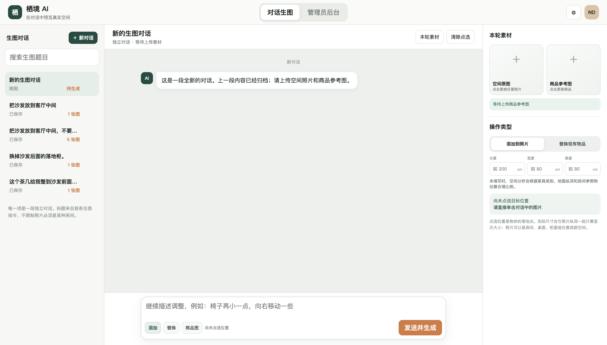

## 4 第一次生成：完整操作流程

以下按真实操作顺序编号。每一步说明"做什么、会看到什么、完成标志"。

### 4.1 新建一段对话（建议）

- 做什么：点击左上角"＋ 新对话"按钮。
- 会看到：左侧出现新条目"新的生图对话"，中间消息区变为空白提示"这是一段全新的对话。上一段内容已经归档；请上传空间照片和商品参考图"。
- 完成标志：屏幕出现"新对话已清空，上一段已归档"提示，输入区为空。

也可以直接使用默认打开的示例对话，不必新建；两者功能相同。

### 4.2 上传空间照片

- 做什么：点击右侧"空间原图"图块，选择一张房间照片。
- 会看到：图块缩略图更新为你的照片；屏幕出现提示"空间原图已保留：XXXX×XXXX"（照片实际像素）；消息区出现"本轮输入"图片卡片。
- 完成标志：右侧图块显示你的照片，且出现像素尺寸提示。

注意 1：如果提示"空间原图超过 10MB"，请先压缩（不要裁切）再上传。
注意 2：在同一段对话里重新上传空间照片，会清空这段对话的消息记录并清除点选位置。想保留之前的成果，请新建对话或换一段对话再传。
注意 3：点击"替换现有物品"时，请确保照片里确实有这件旧家具，并且尽量拍全。

### 4.3 上传商品参考图

- 做什么：点击"商品参考图"图块，选择商品照片。
- 会看到：状态栏先显示"正在优化商品参考图尺寸…"（系统自动压缩），随后变为"商品原图已作为参考图保存 · 不会在浏览器直接抠图或叠加"。
- 完成标志：图块缩略图更新，状态栏显示上述"已保存"文案。

如果提示"商品图读取失败，请更换 PNG 或 JPEG 图片"，换一张重新上传即可。

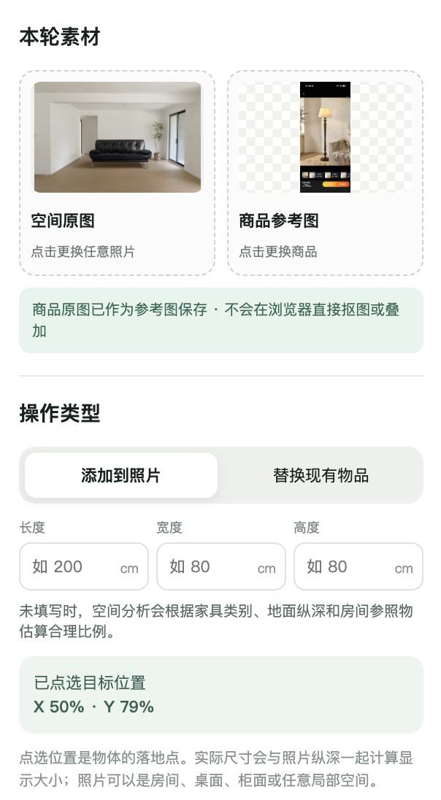

### 4.4 选择操作类型

- 做什么：在"操作类型"区域点击"添加到照片"或"替换现有物品"。
- 会看到：被选中的按钮变白高亮；输入框下方的"添加/替换"标签同步切换。
- 完成标志：屏幕出现提示"添加模式：点选家具底部中心"（或"替换模式：点选要替换物体的中心或接地点"）。

- 添加：保留房间原有的一切，只在新家具附近做融合。
- 替换：只移除被点选的那件旧家具，附近无关物品和小摆件在合理情况下会保留。

### 4.5 填写尺寸（可选）

- 做什么：在"长度/宽度/高度"三个输入框中填写商品的真实厘米尺寸，只能填正数。
- 会看到：填入数字后，下方提示变为"已输入真实尺寸；空间分析会把厘米尺寸与地面纵深、透视比例共同送入生成模型"。不填时提示"未填写时，空间分析会根据家具类别、地面纵深和房间参照物估算合理比例"。
- 完成标志：三个框留空或均为有效数字。填错的值（0、负数、非数字）会被当作"未填写"。

建议：知道真实尺寸就填，比例会更准确；不知道就留空，不要乱猜。

### 4.6 点选摆放位置（必做）

- 做什么：单击对话区中照片上的目标位置。这个点代表"家具底部中心接触地面/桌面的位置"。
- 会看到：照片上出现一个橙色圆点标记；屏幕提示"落点已按原图归一化坐标记录"；右侧"已点选目标位置 X 20% · Y 67%"卡片更新坐标。
- 完成标志：右侧卡片显示具体的 X、Y 百分比坐标。

- 落地家具（沙发、落地灯、床、柜子等）：点在地面上，不要点在墙上半空。
- 桌面/柜面物品（台灯、花瓶等）：点在桌面或隔板上。
- 想重选：点照片上的其他位置即可覆盖；想清空：点击消息区上方"清除点选"按钮（会提示"已清除点选位置"）。

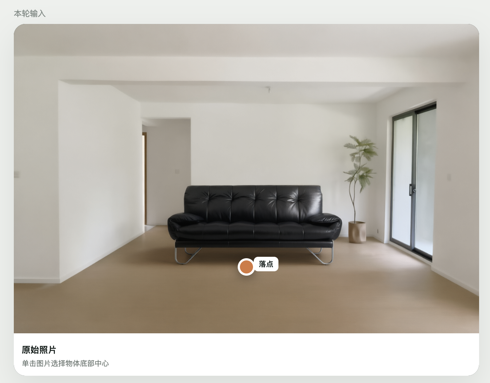

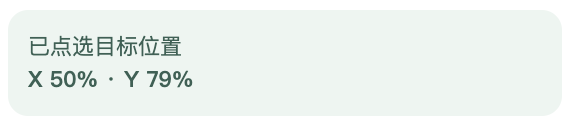

### 4.7 输入要求并发送

- 做什么：在底部输入框用一句自然语言描述要求，例如"把这把椅子放在窗边，稍微朝向镜头"。然后点击"发送并生成"（或按 Ctrl+Enter / Cmd+Enter）。
- 会看到：输入框清空，发送按钮暂时变灰不可点。
- 完成标志：消息区出现你的消息气泡（"添加：xxx"或"替换：xxx"）和五阶段进度卡，生成正式开始。

四项缺一不可：文字要求、空间照片、商品图、点选位置。缺少任何一项，发送时都会弹出提示告诉你缺什么，不会开始生成。

发送后对话标题会自动取自你的第一句要求（去掉"添加/替换"开头，最多 18 个字）。

### 4.8 生成前确认弹窗（可能不出现）

以下两种情况系统会在生成前弹窗，其余情况直接开始：

- 点选和文字矛盾：例如你在照片右侧点了点，但文字写"放到左边"。弹窗问"你选择的位置与文字描述不一致，请确认以哪一个为准"，选项是"以点选位置为准"和"以文字描述为准"。
- 落点明显不合理：例如落地灯点在墙面中部。弹窗说明原因并给出建议位置（如"建议位置为 X 50%、Y 68%"），选项是"使用建议位置"和"仍按原位置"。

另外，落点只有轻微偏差时系统会静默自动调整，不弹窗、不提示。

已知问题（选择后请核对）：选"以文字描述为准"后，坐标可能没有真正移动（当前版本的一个已知缺陷）。确认后请看右侧坐标卡片是否更新；如果没变，请手动在照片上重点选一次。

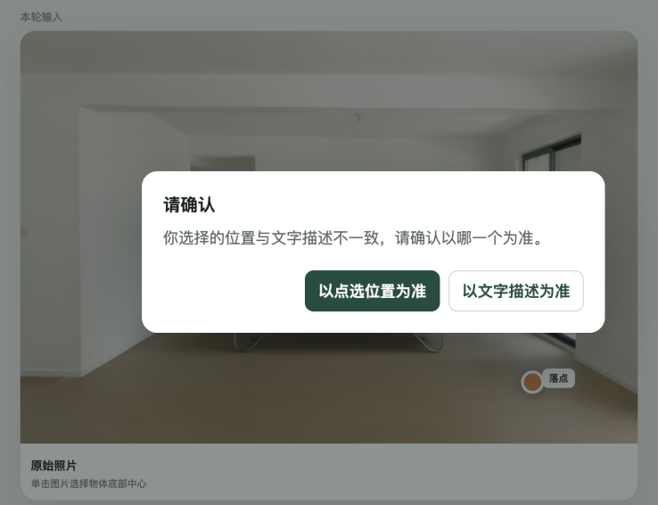

### 4.9 查看进度与等待

生成期间会看到五个阶段依次点亮：

1. 正在理解需求（系统分析房间结构）
2. 正在生成基础效果（第一张图）
3. 正在优化空间与光影（第二张图，综合修正）
4. 正在检查结果（自动质检，不生图）
5. 完成

- 当前阶段橙色高亮，完成变绿；期间会不定期提示"XX 正在百炼后台处理…"，说明任务在云端排队或处理中，不是卡死。
- 等待期间可以点开其他历史对话查看，不会影响本任务——结果完成后会自动写回它所属的那段对话（屏幕会提示"V1 已生成，已写回任务创建时的对话"）。
- 不要关闭或刷新页面：关闭页面后任务不会在后台继续，也不会自动恢复。
- 完成标志：出现"效果图"卡片和 AI 说明消息（见 4.10），或出现失败提示（见第 9 节）。

### 4.10 查看结果

成功后会看到一张效果图卡片，标题"效果图 V1"，下方标注：基于哪张图、尺寸、质检状态、生成次数。卡片上有三个按钮：

- 引用这张图
- 下载
- 重新生成

质检状态三种含义：

| 状态 | 含义 | 图片能用吗 |
| --- | --- | --- |
| QC PASS | 通过自动质量检查 | 能，正常使用 |
| QC WARN | 质检仍提示一些问题（卡片下方 AI 消息会列出） | 能，建议人工确认效果 |
| QC 待确认 | 图已正常生成，但质检服务当时不可用 | 能，可查看、引用和下载，只是没做自动质检 |

每次成功后，这段对话会累积版本号（V1、V2、V3……），左侧对话条目上的"N 张图"徽标同步更新。

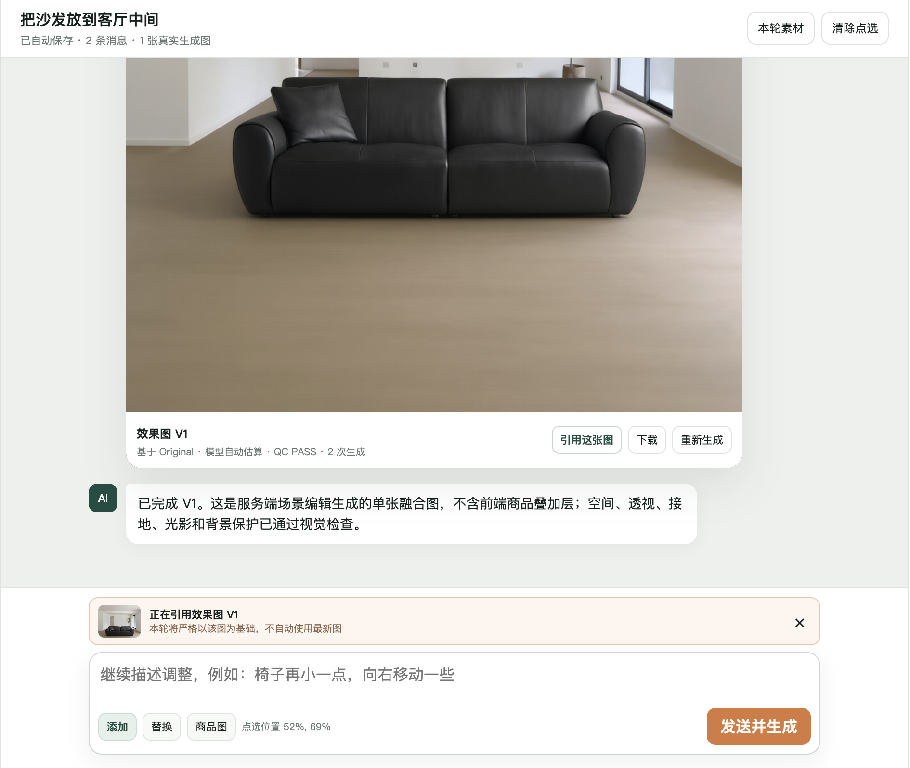

## 5 继续修改或重新生成

### 5.1 引用结果继续调整（推荐）

想在刚生成的图上继续改（比如"椅子再小一点""向右移动一些"）：

- 做什么：点击结果卡片上的"引用这张图"，然后在输入框输入新的要求，点"发送并生成"。
- 会看到：输入框上方出现橙色引用条"正在引用效果图 V1 · 本轮将严格以该图为基础，不自动使用最新图"；发送后走正常生成流程。
- 完成标志：引用条出现并保持展示状态；新一轮结果版本号 +1。
- 取消引用：点引用条右侧的"×"，之后恢复使用最新效果图作为基础。

也可以引用更早的历史版本——在对应历史结果卡片上点"引用这张图"即可。

### 5.2 成功卡上的"重新生成"（整体重来）

- 做什么：直接点击结果卡上的"重新生成"。
- 实际行为：系统自动填入一句固定的优化要求（"基于相同素材重新生成，重点修正空间比例、透视、接地与光影融合"）并用当前界面素材立即发起一个全新任务。
- 适用：整体效果不满意、想换一版时。注意它不会沿用你上次写的具体要求。

### 5.3 失败后的"重新生成"（原样重试）

生成失败时会出现红色"重新生成"按钮：

- 实际行为：沿用原任务的素材、位置、尺寸和文字要求，从头再走一遍完整流程。
- 适用：因为网络或服务波动导致的失败。
- 如果提示"原任务素材不完整，无法直接重试"（多发生在刷新页面之后），需要按第 4 节重新准备素材再发一次。

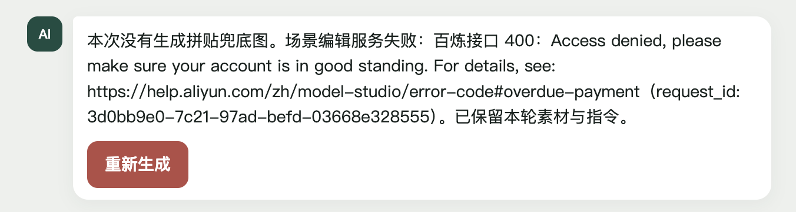

### 5.4 调整话术建议

效果不理想时，与其笼统说"重新生成"，不如引用该图后给出具体指令：

- 大小问题："整体缩小 20%"、"高度按 60 厘米处理"（可配合尺寸输入框）
- 位置问题："向右移一些，靠近窗边"
- 角度问题："椅背稍微转向镜头"
- 遮挡问题："让前景的茶几自然挡住椅子下半部分"

## 6 下载图片

- 做什么：点击结果卡片上的"下载"按钮。
- 会看到：浏览器保存一张名为"栖境AI-效果图.png"的图片文件。
- 完成标志：文件出现在你的下载目录。

如果浏览器没有直接下载、而是打开了图片页面，在图片上右键选"图片另存为"即可。历史对话里的旧结果同样可以下载（打开那段对话，找到对应结果卡片）。

## 7 历史记录管理

### 7.1 自动保存

- 每段对话（含消息、结果图、素材引用）会自动保存在当前浏览器，无需注册登录。
- 保存上限：约 12 段对话、20 条任务记录；超出后较早的内容可能不再保留。
- 每条结果图片的访问依赖云端图片链接，链接的有效期由服务方决定（长期有效性待确认）。重要图片请及时下载。

### 7.2 新建、切换与搜索

- 新建：点"＋ 新对话"，当前对话自动归档。
- 切换：点击左侧任意对话条目，恢复该对话的全部内容（提示"已恢复自动保存的独立对话"）。
- 搜索：在左侧搜索框输入关键词，列表实时过滤。

### 7.3 删除对话

- 做什么：鼠标移到左侧某条对话上，出现红色"删除"小按钮，点击它。
- 会看到：确认弹窗"确定删除该历史对话吗？删除后无法恢复"，选项"确认删除/取消"。
- 完成标志：提示"历史对话已删除"，该条目消失；删除的是当前打开的对话时会自动切换到列表中的下一段。
- 限制：该对话有任务正在生成时不能删除（会提示"该对话仍有生成任务进行中，请等待完成后再删除"）。刷新页面后，如果之前的任务记录停留在"Running"状态，也可能暂时无法删除，需等待或稍后处理。

### 7.4 重要边界

- 历史只保存在当前浏览器：换电脑、换浏览器、清除浏览器站点数据都会丢失；不同设备之间不互通。
- 删除对话只删除本机记录，不删除云端已生成的图片文件（云端留存策略待确认）。

## 8 管理员后台（业务与运营使用）

点击顶部"管理员后台"页签即可进入，没有任何账号密码——这意味着任何能打开页面的人都能看到，对外演示时请注意。

- 任务列表：每个任务的编号、对话题目、操作类型、基础图版本、状态、过程图数量；点"查看真实流程"看详情。

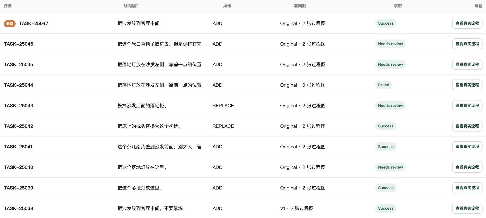

- 生成流程详情：Round 0 需求解析、Round 1 基础生成、Round 2 综合修正、Round 3 质量检查四个卡片。Round 1、Round 2 展示两张真实过程图；Round 0、Round 3 展示分析/质检 JSON 文字结果。每轮可展开查看当时实际使用的 Prompt、开始/结束时间、耗时和百炼 request_id（排查问题时提供此编号给技术人员）。

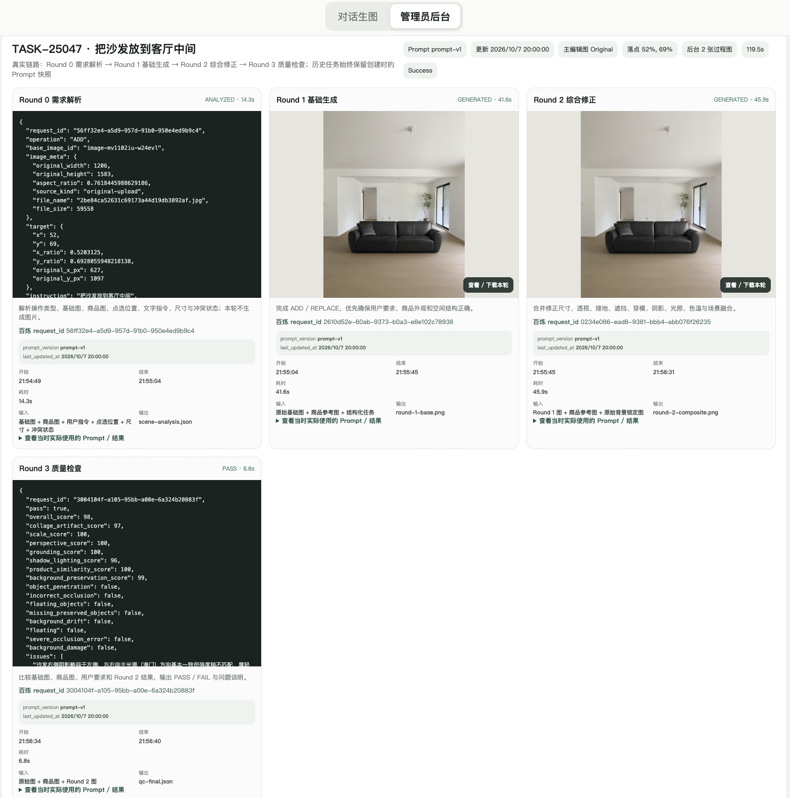

- Prompt 管理：四轮提示词模板可分别编辑、保存、取消、恢复默认。保存即生效（版本号自动 +1），只影响之后的新任务；历史任务展示的仍是它创建时的 Prompt。右上"同步最新任务"按钮可刷新任务列表、Prompt 版本和各轮图片。

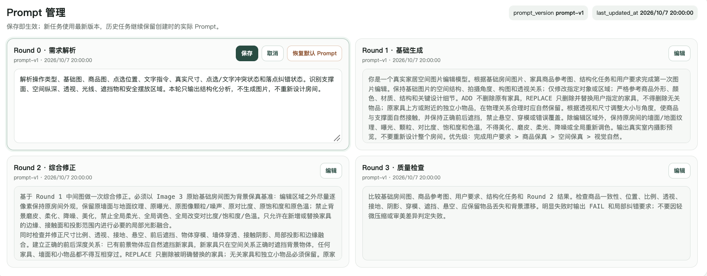

用途建议：核对"结果是否真实由模型生成"、排查失败原因（结合 request_id）、按品类微调提示词模板以改善生成质量。修改 Prompt 前建议先与技术同学确认影响面。

## 9 常见问题与处理建议

**问：生成要等多久？是不是卡死了？**
正常几分钟。模型排队时可能 10–20 分钟。只要进度卡还有阶段在变化、或出现"正在百炼后台处理…"提示，就是正常的，请勿关闭页面。如果最终提示"本轮生成超过等待时间，请稍后重试"，等一两分钟再点失败卡上的"重新生成"。

**问：提示"Failed to fetch"或生成失败怎么办？**
多为网络波动或服务暂时不可用。点"重新生成"用原素材重试；连续失败请稍后再试，不建议短时间内反复提交（每次重试都是一次新的完整生成，消耗模型调用量）。

**问：失败信息里有"百炼接口 500"和一串编号（request_id）？**
这是云端服务端错误。截图保留编号反馈给技术/运营对接人排查，稍后重试。

**问：错误信息是"百炼接口 400：Access denied"，还提到 overdue-payment？**
这不是操作问题，是产品背后的百炼模型账户欠费或额度异常。点击"重新生成"无法解决，请联系运营/管理员检查阿里云百炼账户的缴费与额度状态，结清后再重试。

**问："QC 待确认"是什么意思？图片能用吗？**
图片已正常生成，只是自动质检服务当时不可用。可以正常查看、引用、下载；介意的话可引用该图再生成一版。

**问："QC WARN"是什么意思？**
自动质检后仍存在提醒（AI 消息里会列出具体问题，如遮挡、比例）。图片可用，建议人工看一下效果再决定是否继续调整。

**问：家具位置不对/贴太近怎么办？**
引用该图，用具体文字指出改动（"向左移到离沙发 30 厘米的位置"）；必要时重新点选落点。注意第 4.8 节的已知问题：方位冲突弹窗选"以文字描述为准"后坐标可能未更新，请核对右侧坐标，必要时手动重点选。

**问：比例不对/太大太小？**
引用该图说明目标（"缩小到原来的 70%"），或在尺寸框填真实厘米尺寸后重新生成。

**问：背景被改变了、原图区域被"美颜"了？**
引用该图并说明"背景保持原样，不要调色"，或点"重新生成"。生成约束已包含背景保护，个别情况仍可能漂移，属于当前模型能力边界。

**问：不小心重新上传了空间照片，之前的内容没了？**
这是当前版本的设计：同对话重新上传空间照片会清空消息并重置点选。重要成果请提前下载，或新建对话再操作。

**问：刷新/关闭页面后任务还会继续吗？**
不会。生成不会在后台续跑，刷新后也不会自动恢复正在进行的任务。请等待任务完成后再关闭页面；误关后只能重新发起。

**问：换了一台电脑，历史怎么没了？**
历史只存在当前浏览器本地，不同设备不互通。重要图片请下载保存。

**问：手机上打不开上传面板？**
当前版本在窄屏（约 800px 以下）会隐藏左右面板，点击"本轮素材"会提示"素材面板在桌面宽度下显示"。请用桌面电脑操作。

**问：支持什么图片格式？**
空间照片：PNG、JPEG，不超过 10MB。商品图：常规图片即可，系统自动压缩转换。过大的空间照片请先压缩（不要裁切）。

**问：照片很暗或模糊能用吗？**
偏暗照片通常可以生成。极模糊的照片缺少"建议重新上传"的提醒（当前版本未实现清晰度检测），但生成质量会受影响——建议直接换清晰照片。

**问：生成结果里出现了商品图上的文字、价格牌或水印？**
个别情况模型会把商品页元素带进图里。换一张更干净的商品图（纯商品主体、无促销文字）重新生成。

**问：谁可以看到我的历史和图片？**
历史保存在你自己的浏览器里；但页面本身没有登录门槛，请勿在公共电脑上使用。照片会上传至阿里云百炼做生成处理（见第 2 节隐私提示）。

## 10 配图说明与插图索引

正文中的插图均保存在项目文件夹"文档配图/"内；除流程图为 AI 生成示意图外，其余全部为真实运行截图。正文文字不依赖图片也可独立指导操作。

### 10.1 用户操作流程图

文字节点与连接关系：打开页面 → 是否新建对话（否则选择历史对话）→ 上传空间照片 → 上传商品参考图 → 选择添加/替换 → 可选填尺寸 → 照片上点选落点 → 输入要求发送 → 可能出现确认弹窗（按提示选择后继续）→ 等待五阶段 → 成功看效果图（引用继续调整则回到"输入要求"；整体重来点重新生成；满意则下载）/ 失败点重新生成重头再来。

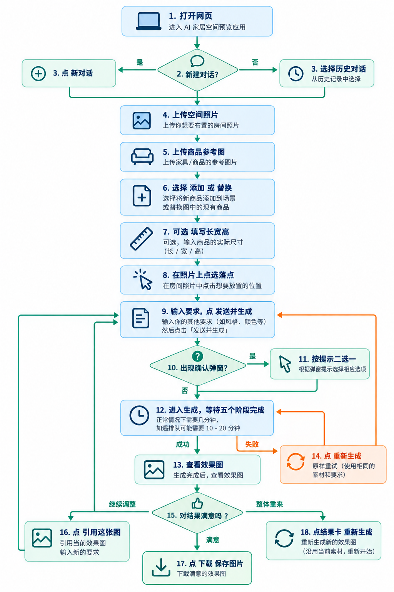

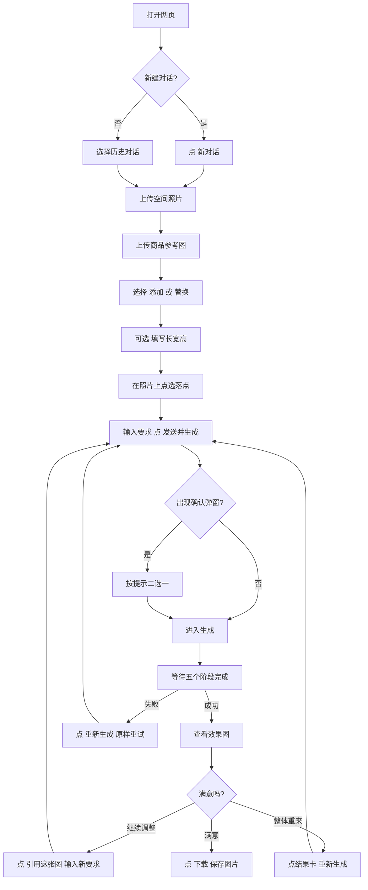

绘制说明：建议纵向单栏布局，从上到下为主线；"满意吗"用菱形判断节点，三个出口分别指向"下载（终点）"、"引用调整（回到输入）"和"重新生成（回到输入）"；失败分支用暖色（橙/红）区分。可在"等待五阶段"节点旁标注"正常几分钟，排队可能 10–20 分钟"。

English image prompt: Create a friendly vertical user-journey infographic for a web app that previews furniture inside a user's own room photo. Clean modern flat design, white background, soft green and warm orange accents, rounded rectangles for steps, diamond for the single decision point, thin arrows connecting steps top to bottom. Steps in order: Open the website → Start new conversation or pick a history chat → Upload room photo → Upload furniture product photo → Choose Add or Replace → Optionally fill real dimensions → Click a placement point on the photo → Type the request and press Generate → A confirmation popup may appear → Wait through five progress stages with a note "usually a few minutes, may take 10–20 minutes when queued" → View the generated preview image. End with a decision "Happy with the result?": yes leads to Download the image; "adjust further" loops back to type a new request referencing the image; "start over" loops back to generate again. A separate failure branch in orange shows "generation failed → press Regenerate to retry with the same materials". Use simple line-style icons (camera, sofa, cursor click, clock, download arrow), large readable labels, generous spacing, no decorative room photography, no fake UI screenshots.

### 10.2 已嵌入插图索引

| 图号 | 内容 | 所在章节 |
| --- | --- | --- |
| 图 1 | 全新空对话三栏全页布局 | 第 3 节 |
| 图 2 | 素材面板上传完成状态 | 4.3 之后 |
| 图 3 | 照片上的橙色落点标记 | 4.6 |
| 图 4 | "已点选目标位置"坐标卡片 | 4.6 |
| 图 5 | 点选/文字冲突"请确认"弹窗 | 4.8 |
| 图 6 | 结果卡"效果图 V1"与引用条 | 4.10 |
| 图 7 | 失败消息卡与"重新生成"按钮 | 5.3 |
| 图 8 | 管理员后台任务列表 | 第 8 节 |
| 图 9 | 管理员后台生成流程详情（四轮卡片） | 第 8 节 |
| 图 10 | 管理员后台 Prompt 管理 | 第 8 节 |
| 图 11 | 用户操作全程流程图（AI 生成示意图） | 10.1 |

待补截图（当前素材中未提供，后续可补入）：五阶段进度卡等待状态（4.9）、下载后的本地文件"栖境AI-效果图.png"（第 6 节）。补图要求：来自真实运行状态，不拼接、不摆拍，遮蔽浏览器个人账号、插件浮层和隐私图片内容。

### 10.3 其他配图

本指南不需要 AI 生成的配图：操作顺序用 10.1 流程图表达，界面细节用真实截图表达即可。AI 生成图容易让用户误以为是真实界面，反而造成误导。

## 11 版本说明

- 本指南基于 2026-10-09 冻结的 V2_test 可运行基线编写（基线提交 7f9f3c0），于 2026-10-11 依据当前代码逐项核对操作路径、按钮文案和提示信息。
- 待确认项已随文标注：线上是否仍运行该基线、具体浏览器兼容范围、移动端正式支持、云端图片链接保留期限、云端数据留存策略。
- 若功能更新，请同步更新本指南，不要保留已失效的操作描述。
