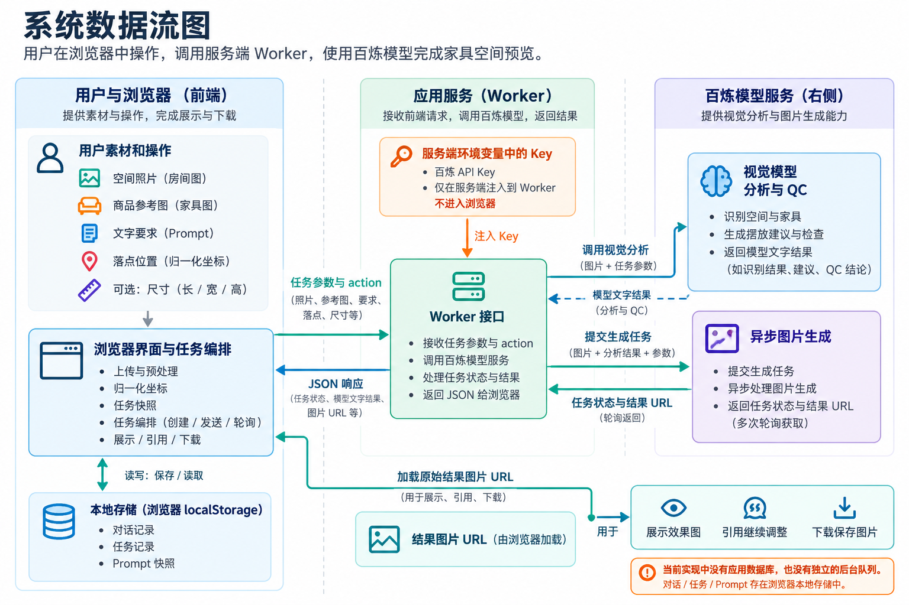
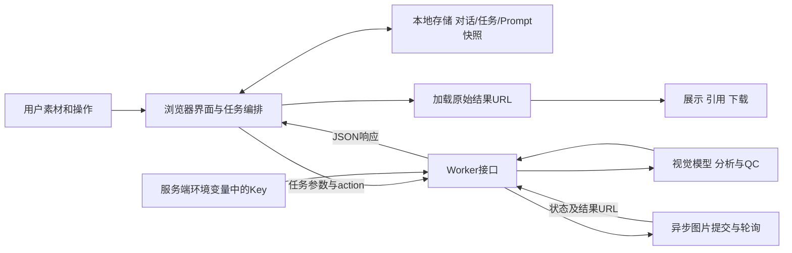
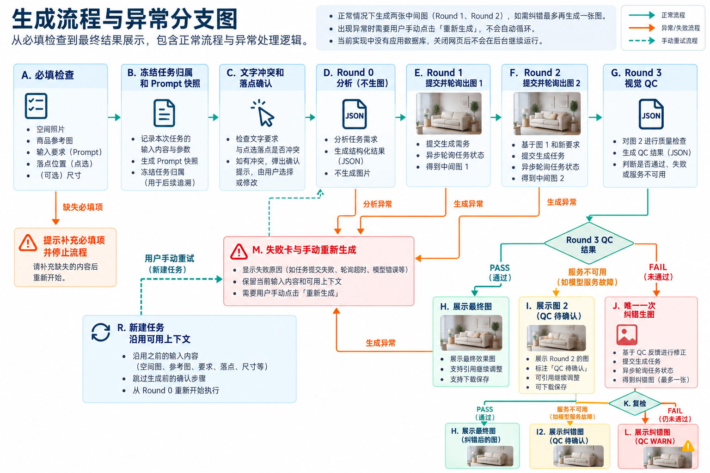
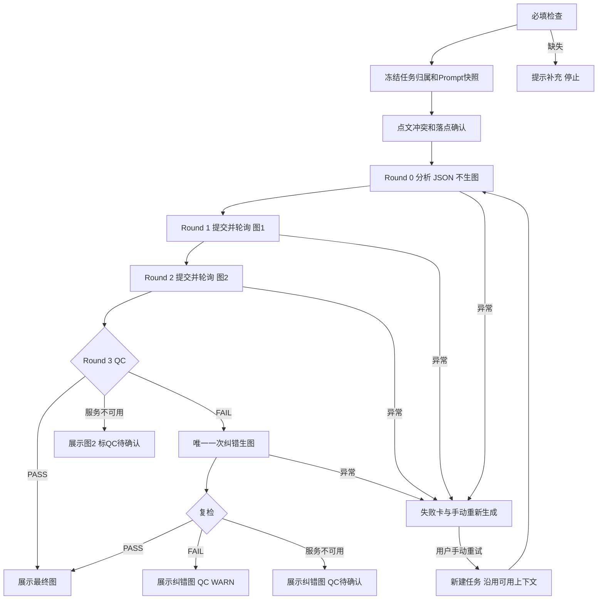

# 栖境 AI 家居空间预览 · V2 技术说明文档

面向产品、业务与项目交接人员。以真实代码和已实现功能为准编写。

核对日期：2026 年 10 月 11 日。核对方式：逐行阅读当前工作目录的 dist/index.html、dist/app.js、worker/index.js、scripts/ 两个脚本，比对 V2_test 冻结归档的校验值，提取 PRD 文档中的 12 条测试记录与 V1→V2 修改记录，并参考 skill_bug 交接手册。本文描述的是 V2（当前最新版 HTML 及其配套服务端）。

## 0 阅读前必读的三个结论

1. 这个产品不是"浏览器抠图贴图"，也不是三维渲染软件。它由浏览器负责收集素材和编排步骤，由服务端（Worker）调用阿里云百炼的图片模型重新"生成"一张融合图，再用视觉模型做质量检查。
2. 正常一次任务实际生成两张图（Round 1 基础生成、Round 2 综合修正）；需求解析（Round 0）和质量检查（Round 3）只输出文字分析、不生图。若质检明确不通过，最多额外生成一张纠错图并复检一次，不会无限重试。
3. 对话历史、任务记录、Prompt 配置都保存在当前浏览器的 localStorage 里。换浏览器、换设备或清除站点数据都会丢失。关闭网页后，正在进行的任务不会自动续跑。

术语速读：Worker＝运行在托管服务端的接口程序；API＝程序之间传递请求和结果的入口；JSON＝按字段组织的文字数据；QC＝质量检查；轮询＝隔几秒查询一次异步任务是否完成；Data URL＝把文件内容直接写成字符串的图片表示方式；localStorage＝浏览器提供的本地键值存储。

## 1 项目地址与项目文件

### 1.1 线上地址与部署身份

| 项 | 值 |
| --- | --- |
| 线上地址 | https://qijing-ai-home-preview.mawellhihi.chatgpt.site/ |
| Sites 项目 ID | appgprj_6ac1d507ee648191acf8cc8b326860eb |
| 冻结时网站版本号 | 21 |
| Git 基线提交 | 7f9f3c03d1ac6b652aa9a8c649168660a821e882 |
| 部署 ID | appgdep_6ac71fb85df88191a3de9d5d9ad688a4 |
| 归档时间 | 2026-10-09（V2_test 目录冻结） |

注意：网址可能继续发布新版本，不能只看网址判断代码版本；应同时核对 Git 提交、Sites 版本号和文件校验值。本次已确认：当前工作目录的 dist/app.js、dist/index.html、worker/index.js 与 V2_test 归档内对应文件的 SHA256 完全一致。当前线上运行的模型环境变量值、部署状态和实时成功率未重新验证，待确认。

### 1.2 目录结构与文件职责

| 文件或目录 | 实际作用 |
| --- | --- |
| dist/index.html | 唯一的页面文件，包含页面结构和全部内嵌 CSS，约 28KB |
| dist/app.js | 前端逻辑，原生 JavaScript（无框架），约 54KB、184 行紧凑代码 |
| dist/assets/ | 两张内置示例图（living-room.png 空间示例、caramel-chair.png 商品示例），不是用户上传图的服务端归档 |
| worker/index.js | 服务端模板，定义 API 路由、百炼调用、Prompt 组装、参数校验和 QC，约 33KB |
| dist/server/index.js | 构建后的 Worker 产物（约 6.4MB），内嵌页面、前端脚本和两张示例图；部署运行的是它 |
| scripts/build-worker.mjs | 构建脚本：把页面、脚本、图片填入 Worker 模板占位符 |
| scripts/validate-worker.mjs | 校验脚本：对构建产物做约 50 项关键字符串存在性检查 |
| .openai/hosting.json | 只保存 Sites 项目 ID，不含运行时密钥 |
| V2_test/ | 冻结代码快照（含 README、DEPLOYMENT_INFO、SHA256SUMS） |
| V1/、V1_test1/ | 旧版本归档；V1_test1 已加入 .gitignore 隔离，不应覆盖 |
| skill_bug/ | 交接手册：历史 Bug 案例与维护原则 |
| prd_assets/ | 已截好的产品截图（主流程、冲突确认、后台轮次、Prompt 管理等） |
| 两个 PRD docx | 产品需求文档：图文完整版与"当前实现与测试"版 |

技术选型事实：前端没有使用 React/Vue 等框架，也没有前端构建链；Worker 使用标准 Request/Response/fetch 接口。运行部署环境自带页面和静态资源，浏览器无需安装任何东西。

### 1.3 构建与本地运行边界

build-worker.mjs 把 index.html、app.js 和两张示例图用 JSON.stringify 安全嵌入 worker/index.js 的占位符（__PAGE__、__APP_JS__、__ROOM_BYTES__、__PRODUCT_BYTES__），字符串替换使用回调形式，避免源码里的特殊符号被误当作替换语法。产物写入 dist/server/index.js。

本地直接双击 index.html 打开只能看到界面：前端请求的是相对地址 /api/generate-stage，file:// 或普通静态服务器都没有这个服务端路由，完整生成流程无法运行。完整体验需访问线上站点，或自建等价 Worker 并配置环境变量。

提交前的常规检查（交接手册建议）：

```bash
node --check dist/app.js
node scripts/build-worker.mjs
node scripts/validate-worker.mjs
git diff --check
```

本次已执行 node --check dist/app.js 通过；validate-worker.mjs 对现有构建产物校验通过。该校验只做字符串存在性检查，不能证明坐标计算正确、模型在线或图片质量合格。

## 2 主要页面与业务入口

实际是一个 HTML 里的两个视图，顶部"对话生图 / 管理员后台"两个页签切换，不是两套系统。

### 2.1 对话视图（普通用户）

三栏布局：左侧历史对话列表；中间聊天流；右侧素材面板。

- 左侧：每个条目是一段独立对话，可新建、搜索、切换、删除（删除需二次确认，运行中任务的对话禁止删除）。初始还有 5 条预置示例题目，属于界面演示数据，其"3 张图"等徽标不是真实生成记录。
- 中间：文字消息与生成图片在同一条对话流里。结果卡片提供"引用这张图、下载、重新生成"。
- 右侧：上传空间原图和商品参考图、选择"添加/替换"、填写可选的长宽高（厘米）、查看点选位置。

发送前的必填检查：文字指令、空间图、商品图、点选位置，缺一项都会用 toast 提示。尺寸只接受可解析的正数，否则按未填写处理；没有尺寸上下限校验，也没有"明显放不下"的定量判断。聊天外观不等于通用 AI 问答：发送入口始终走图片任务，没有独立的纯文本问答接口。

两个"重新生成"不一样，业务同学最容易混淆：失败消息里的"重新生成"复用旧任务的素材与指令（详见 6.4）；成功卡片上的"重新生成"则只是自动填入一条固定的优化指令（"基于相同素材重新生成，重点修正空间比例、透视、接地与光影融合"），然后用当前界面素材新建任务。

### 2.2 管理员视图

同一页面的第二个页签，没有登录、角色或权限校验，任何打开页面的人都能看到，只能视为演示后台。功能：

- 任务列表：任务号、对话题目、操作类型、基础图版本、状态、过程图数量。
- 生成流程详情：Round 0 至 Round 3 的每轮卡片，显示实际图片（生图轮）或 JSON 结果（分析/质检轮）、Prompt 全文、prompt_version、开始/结束时间、耗时、百炼 request_id、输入输出摘要。
- Prompt 管理：四轮模板分别查看、编辑、保存、取消、恢复默认（详见 5.2）。

### 2.3 移动端

宽度不超过 800px 时隐藏左侧历史栏和右侧素材栏，"本轮素材"按钮只弹 toast 提示"素材面板在桌面宽度下显示"。也就是说移动端没有完整的上传入口，有响应式样式不等于移动端业务已验收。

## 3 技术方案总览

一句话架构：浏览器做"任务编排器"，Worker 做"模型网关"，百炼做"生成引擎"，localStorage 做"历史仓库"。

- 浏览器负责：上传与压缩素材、记录原始宽高、归一化点选坐标、冻结任务快照、调用 Worker 接口、轮询异步生图任务、展示阶段进度和结果、维护对话历史和 Prompt 配置。
- Worker 负责：参数校验、Prompt 组装、携带服务端密钥调用百炼、提交/查询异步图片任务、执行视觉分析和质检、返回 request_id 和图片 URL。
- 百炼负责：实际的图像理解与图片生成。

关键设计原则（也是 V1→V2 的核心转变）：房间照片是主编辑图，商品照片只是外观参考，最终图由模型整体重绘生成，绝不在浏览器里把商品抠出来贴上去。空间关系、尺寸、遮挡全部由模型推断，代码里没有深度图、相机标定、三维网格或物理碰撞检测。

## 4 模型与真实接口

### 4.1 模型配置

| 用途 | 代码默认值 | 环境变量覆盖 |
| --- | --- | --- |
| 空间分析（Round 0）与质量检查（Round 3） | qwen3-vl-plus（视觉理解模型） | VISION_MODEL |
| 图片编辑生成（Round 1、Round 2、纠错） | qwen-image-3.0（图像编辑模型） | IMAGE_EDIT_MODEL |
| 百炼地址根路径 | https://dashscope.aliyuncs.com | DASHSCOPE_BASE_URL |
| 服务端凭据 | 无默认值，必须配置 | DASHSCOPE_API_KEY |

"视觉模型"＝能看图并输出文字分析的模型；"图像编辑模型"＝根据图片和文字要求输出新图的模型。以上是代码默认配置；当前线上环境实际生效的模型名、区域和额度，待确认。

GET /api/health 可返回配置是否存在（configured）和当前选用的模型名，但前端代码从未主动调用它，configured=true 只说明配置了 Key，不代表鉴权成功或额度充足。

### 4.2 浏览器访问的项目接口（真实路由，来自 worker/index.js）

| 方法与路径 | 作用 | 当前前端是否使用 |
| --- | --- | --- |
| GET /api/health | 诊断：返回 ok、configured、模式、模型名 | 未使用 |
| POST /api/generate-stage | 分阶段任务接口，当前主路径 | 是（唯一使用的生成接口） |
| POST /api/generate | 一次提交完整任务、同步返回全流程结果 | 否（保留的兼容路径） |
| OPTIONS 任意路径 | 返回跨域预检响应头 | 浏览器自动触发 |
| GET /、/app.js、/assets/*.png | 返回内嵌页面、脚本、示例图 | 是 |

/api/generate-stage 支持 6 种 action：

| action | 输入要点 | 输出 |
| --- | --- | --- |
| analyze | 基础图、指令、坐标、尺寸、冲突说明、Prompt 快照 | 空间分析 JSON + Round 0 记录 |
| base | 基础图、商品图、上一步分析 | 百炼异步任务 ID + Round 1 记录 |
| composite | 上一轮图片 URL、商品图、原始基础图、分析 | 百炼异步任务 ID + Round 2 记录 |
| retry | 同上，另带 QC 纠错要求 | 百炼异步任务 ID + 纠错轮记录 |
| quality | Round 2 结果 URL、三图与分析 | QC JSON + Round 3 记录 |
| poll-image | 仅百炼任务 ID | 任务状态与结果图片 URL |

服务端校验（validatePipelineInput）：图片必须是 PNG/JPEG/WebP 的 Data URL（长度上限约 1400 万字符，对应约 10MB）或 HTTPS 地址（上限 4096 字符）；必须携带原图宽高和宽高比；必须有有效点选坐标；指令非空且截取至 1600 字符；操作只接受 ADD/REPLACE。校验失败统一返回 HTTP 500 和中文错误信息（没有区分 4xx 用户错误与 5xx 服务故障，这是个已记录的待优化点）。

### 4.3 Worker 访问的百炼接口（真实上游路径）

| 上游路径 | 用途与调用方式 |
| --- | --- |
| POST /compatible-mode/v1/chat/completions | 视觉分析与 QC。temperature=0.1，要求 JSON 输出 |
| POST /api/v1/services/aigc/image-generation/generation | 图片生成主路径。请求头带 X-DashScope-Async: enable，提交异步任务拿 task_id |
| GET /api/v1/tasks/{taskId} | 轮询任务状态：PENDING、运行中、SUCCEEDED、FAILED 等；成功时从返回体取结果图 URL |
| POST /api/v1/services/aigc/multimodal-generation/generation | 同步多模态生成，仅保留的 /api/generate 兼容路径使用 |

所有上游请求由 Worker 在 Authorization 头携带服务端 Bearer Key。图片生成参数：动态 size（按原图比例计算，见 5.4）、n=1、prompt_extend=true、watermark=false。prompt_extend 开启意味着百炼可能对提示词做内部扩展，项目保存和展示的是自己提交的 Prompt，不包含上游的内部改写。

异步提交成功只代表任务受理，不等于图片生成完成。前端随后轮询，只有状态 SUCCEEDED 且返回了结果 URL 才算该轮成功。结果以百炼托管的 HTTPS 图片链接交付，Worker 不落地保存图片文件；管理员后台的"round-1-base.png"等只是逻辑上的输出名称，不是真实存在的文件名。

### 4.4 三种 ID 不要混淆

| ID | 含义 | 谁产生 |
| --- | --- | --- |
| task_id（TASK-25001 起） | 本项目本地任务编号 | 浏览器 |
| 百炼 taskId | 一次异步生图任务编号 | 百炼 |
| request_id | 一次 API 请求的追踪号（用于排查） | 百炼返回，Worker 与前端保存 |

同一业务任务会产生多次模型请求（1 次分析、2 至 3 次生图、1 至 2 次 QC）和 2 至 3 个异步图片任务。

## 5 数据流转与提示词处理

### 5.1 空间图与商品图分别处理

空间原图：readOriginalImage 直接用 FileReader 读成 Data URL，不经过 canvas 重绘，记录 original_width、original_height、aspect_ratio、来源类型、文件名和大小。类型校验接受 PNG/JPEG/WebP，上限 10MB。注意一个不一致：HTML 文件选择框只声明了 PNG/JPEG，所以 WebP 实际上没有正常的界面入口（代码支持、入口未开）。

商品参考图：resizeFile 把最长边缩到不超过 1536 像素（保持比例），绘制到 canvas 后转为 JPEG（质量 0.9）。它不是原始字节保留，透明背景也不会保留（转成了 JPEG）。页面文案"商品原图已保存"应理解为"商品参考内容已保存"，不是"文件未做任何处理"。

引用历史效果图：HTTPS 的历史结果 URL 直接作为下一轮基础图传给 Worker（不再在浏览器里 fetch 后转 Base64，这修复了 V1 引用后 Failed to fetch 的问题）；只有本地相对路径才转 Data URL。历史图长期有效性取决于百炼侧 URL 的保留策略，待确认。

### 5.2 点选坐标（归一化）

点选以图片实际显示边界（getBoundingClientRect）计算：x_ratio =（点击横坐标 − 图片左边界）/ 显示宽度，y 同理；限制在 0 到 1，同时保存四舍五入的百分比。Worker 再把比例乘以原图宽高得到 original_x_px / original_y_px。落点语义是"物体底部中心接触点"。这样做的好处：页面放大缩小都不会让落点漂移。

### 5.3 任务创建即冻结（快照机制）

captureTaskContext 在用户点发送时复制：对话 ID、场景 ID、基础图 ID、基础图来源与元数据、商品图、操作类型、落点、尺寸、指令、当前标题。newTask 再复制一份当时完整的四轮 Prompt 配置（prompt_snapshot）。此后无论用户切换对话、换素材还是改 Prompt，该任务都按创建时的快照执行和写回。

生成前有两类轻量规则检查（不是模型理解）：

- 点选/文字方位冲突：文字含"左侧、左边、靠左、向左"而落点在右侧 65% 以上（或反向，左侧 35% 以下），弹窗让用户二选一：以点选为准 / 以文字为准（文字为准时建议移到 25% 或 75%）。
- 落点合理性：按文字匹配"落地灯、沙发、床、餐桌、茶几、椅子、柜"等品类——落地类物品点在 y<42% 判"明显不合理"需用户确认（建议 y=68%），y<58% 判"轻微偏差"自动纠正到 y=62%；沙发/床等宽家具贴左右边缘（x<16% 或 x>84%）也会提示。它并没有识别墙面、地面或空间容量，只是关键字加坐标阈值。

### 5.4 输出尺寸策略

chooseOutputSize 按基础图比例、以 1536×1024 的面积为目标计算输出尺寸，最长边限制 2048，宽高四舍五入到 16 的倍数；比例超出 1:8 至 8:1 范围时标记 letterbox-no-crop。重要边界：代码没有真正生成"补过边的输入图"，也没有像素级编辑蒙版（mask）；"不裁切"目前是输出尺寸策略加 Prompt 文字约束，模型仍可能重新构图。生成结果的宽高也没有在返回后重新解码核验，若上游返回与请求不一致，后续引用的坐标映射可能有偏差。

### 5.5 一次生图请求的 Prompt 构成

"Prompt"不是用户那句话，而是发给模型的完整任务说明。编辑轮（base/composite/retry）实际提交内容由四部分拼接：

1. EDIT_SYSTEM：服务端固定的英文硬约束（保持构图、机位、墙面/地面纹理、曝光、颗粒和未编辑物体；只在编辑物体及其接触阴影附近做局部融合；ADD 不删旧家具；REPLACE 只删目标家具并合理保留附近小物品；不得把商品页文字、价格牌、水印搬进房间等）。
2. 图片角色说明：base 轮说明 Image 1 是基础房间图（主编辑画布）、Image 2 是商品参考；composite/retry 轮说明 Image 1 是上一轮结果、Image 2 是商品参考、Image 3 是原始基础图（背景保真基准）。
3. 管理员模板：四轮各自的可编辑模板文字（round1/round2）。
4. 结构化任务上下文：操作类型、用户指令、原图尺寸与比例、落点（比例与原图像素）、输出尺寸策略、冲突处理结论、落点纠错结论、尺寸文字、空间分析 JSON；纠错轮额外附加 QC 的纠错要求。

管理员可编辑范围：Round 0 至 Round 3 四个模板。默认只读，点编辑后可保存、取消、恢复默认；"恢复默认"只是把默认文案填回输入框，仍需点保存才生效。保存后版本号加一（prompt-v2、prompt-v3……）并更新时间。retry 没有独立编辑入口：它固定使用 Round 2 模板再加一段服务端内置的纠错约束。EDIT_SYSTEM 也不在可编辑范围内。

版本与生效规则：模板存当前浏览器 localStorage，保存即生效，新任务复制整套快照；历史任务展示的始终是它创建时实际使用的 Prompt，不跟随模板更新。服务端对模板做去空白和 12000 字符截取；版本号标签由客户端提供，不是防篡改的审计版本。前后端各有一份默认模板，修改时须保持两份一致。不同浏览器、不同标签页之间不共享最新模板（没有对应的 storage 同步分支）。

## 6 生图与改图全流程

### 6.1 阶段总览

| 阶段 | 真实输入 | 是否生图 | 输出 |
| --- | --- | --- | --- |
| Round 0 需求解析 | 基础图 + 指令、坐标、尺寸、冲突结论 | 否 | 空间分析 JSON（支撑面、纵深、光线、遮挡、建议朝向等约 20 个字段） |
| Round 1 基础生成 | 基础图 + 商品参考图 + 分析 | 是 | 中间图 1：完成添加或替换 |
| Round 2 综合修正 | 中间图 1 + 商品参考图 + 原始基础图 | 是 | 中间图 2：综合修正比例、透视、接地、遮挡、阴影、色温 |
| Round 3 质量检查 | 基础图 + 商品图 + Round 2 图 + 分析 | 否 | QC JSON：是否通过、评分、问题清单、纠错要求 |

一个重要事实：Round 0 的分析文案里提到"商品参考"，但 analyzeScene 实际只把基础图发给视觉模型，商品图没有传。商品外观要到 Round 1、Round 2 和 QC 才有真实图像参考。Round 2 的主编辑图是上一轮结果，原始基础图作为第三张图传入、仅用于锁定背景。局部性完全依赖多图参考加文字约束，没有 mask 参数强制只改指定像素。

### 6.2 QC 的三分支

QC 输出 pass、overall_score 等分数，以及五个"一票否决"布尔项：object_penetration（穿模）、incorrect_occlusion（错误遮挡）、floating_objects（悬空）、missing_preserved_objects（应保留物丢失）、background_drift（背景漂移）。任何一项为 true 都强制不通过；其余分数没有数值门槛，是模型主观评分。QC 的 Prompt 里没有单独附上用户原话，用户要求只能通过分析 JSON 间接传达。

- QC PASS：直接交付最终图，任务状态 Success。
- QC FAIL：自动追加一次纠错生图（使用 Round 2 模板 + 纠错约束 + QC 纠错要求），纠错图覆盖后台 Round 2 卡片（保留两次尝试的 request_id、时间和 Prompt），然后复检一次。复检通过按 PASS 交付；仍不通过也交付纠错图，标记 QC WARN，任务状态 Needs review。不再有第二次纠错。
- QC 服务不可用（如百炼 500）：前端先自动重试一次 QC；仍失败则保留 Round 2 结果正常展示，标记"QC 待确认"，任务状态 QC unavailable，后台记录 UNAVAILABLE 轮次。模型判失败与检查服务故障是两种不同的状态。

注意一个保护缺口：只有"QC 服务故障"有专门的降级交付。如果失败发生在 Round 1、Round 2 或纠错生图本身，任务整体进入失败逻辑，此时即便 Round 2 曾经成功，前台也不会交付那张图（后台仍可看到）。这是已知限制。

### 6.3 耗时与轮询

每轮生图先提交异步任务，然后轮询：最多 150 次，第一次等 1.2 秒、之后每次 3.5 秒，仅固定等待就约 522.7 秒，另加每次网络耗时；fetch 没有设置 AbortController 超时，所以"约 523 秒"不是硬上限。两轮串行，加上分析与 QC，总耗时完全可能超过 1000 秒（测试 T12 实测 1223.8 秒；历史生产记录显示单轮至少 99 次轮询、约 508 秒，QC 约 11 秒）。

等待体验显示五个阶段（正在理解需求 / 正在生成基础效果 / 正在优化空间与光影 / 正在检查结果 / 完成），不伪造百分比进度。

每轮记录 start_time、end_time 和毫秒 duration。合并纠错后 Round 2 的 duration 是两次尝试之和，与首尾时间差并不相等。任务总 elapsedMs 从执行开始计算，不包含生成前用户确认弹窗的等待时间。

### 6.4 失败重试

失败卡片提供"重新生成"：找到原任务，尝试用保存的任务上下文恢复素材；保存时为控制体积删掉了两个大图字段，因此刷新后会从对话当前素材回填（素材可能已被更换，不能保证与原任务完全一致）。恢复成功则新建任务、跳过生成前确认、沿用原指令从 Round 0 重头执行（不是断点续跑），并使用点击时最新的 Prompt 配置而非旧任务版本。素材不完整时提示"原任务素材不完整，无法直接重试"。

### 6.5 历史失败任务的定向恢复

recoverLegacyQualityFailures 在页面加载时扫描本地任务记录：状态 Failed、无结果、但存在 Round 2 图片、且错误信息明确匹配百炼质检 500（InternalError.Algo.ModelServingError 等）的历史任务，会被改写为 QC unavailable 并把 Round 2 图作为结果交付给所属对话。旧记录没有精确的阶段标识，匹配是启发式的，只能恢复明确符合特征的那部分任务。

## 7 状态保存与历史管理

### 7.1 保存在哪里（localStorage 键）

| 本地键 | 内容 | 数量边界 |
| --- | --- | --- |
| qijing-ai-conversations-v2 | 当前对话 ID + 对话状态（消息 HTML、素材、版本、引用映射等） | 最多保存 12 个 |
| qijing-ai-generation-tasks-v2 | 任务记录（轮次、结果、Prompt 快照、检查点、精简后的上下文） | 最多保存 20 个 |
| qijing-ai-prompt-config-v1 | 四轮模板、版本号、更新时间 | 无显式上限 |
| qijing-ai-deleted-conversations-v1 | 已删对话 ID 集合（防止预置示例历史重现） | 无显式上限 |

localStorage 按浏览器和网站来源隔离，不是云端数据库。保存失败（如空间不足）只在控制台警告，页面仍显示"已自动保存"。对话按 Map 插入顺序取前 12 个持久化，不是"最近使用的 12 个"。历史存的是渲染后的 HTML（feedHTML）而非结构化消息表，后续做迁移、脱敏和数据分析都会更困难。

### 7.2 归属写回

任务完成时按创建时冻结的 conversation_id 写回：用户还在原对话就更新当前界面；已切换对话则从存储取出原对话的 HTML 快照、离屏修改后写回。切换界面不会改变结果归属——这修复了 V1"结果写进错误对话"的严重 Bug。但同一对话内重新上传空间图会更换场景并清空消息区，旧任务仍按对话归属写回，没有场景级隔离。

### 7.3 删除与多标签页

删除流程：运行中任务阻断 → 二次确认 → 删除对话快照、关联任务和已删 ID 记录 → 删除当前对话则切到列表第一个（不是最近访问），无记录则新建空对话。删除是纯前端本地删除，不会删除百炼侧任务或托管图片。

多标签页：storage 事件会合并任务记录和对话，但没有同步"已删 ID"集合和 Prompt 配置，删除一致性和模板一致性存在风险，不能宣称完整解决。

### 7.4 刷新后能恢复什么

- 能恢复：12 个对话（含消息流、素材、版本引用）、20 个任务记录（管理后台可完整回看轮次与 Prompt）、Prompt 配置。
- 不能恢复：正在进行的任务不会自动续跑（checkpoint 只是记录，初始化没有续跑逻辑）；刷新后 Running 状态的残留记录可能一直阻止该对话被删除；任务大图字段被精简，重试要靠对话当前素材回填。

## 8 错误处理

- 输入缺失：toast 提示缺哪项。
- 网络层重试：只对 analyze、poll-image、quality 三种 action 在网络错误或 HTTP 429/502/503/504（quality 额外允许 500）时等 1.8 秒重试一次。生图提交（base/composite/retry）不自动重发，避免重复计费。注意：Worker 把上游异常统一包装成 HTTP 500 返回给前端，可能把上游 429/503 掩盖成 500，导致前端按状态码判断的重试条件不总是命中。
- 模型 JSON 解析失败：Round 0 回退到带警告的兜底分析继续执行；QC 回退为 pass=false（可能触发一次纠错）。
- 错误展示：失败卡显示错误文本和"重新生成"；带 request_id 的百炼错误保留编号便于排查；"Failed to fetch"只说明浏览器到 Worker 的请求失败，不能断言百炼未被调用。
- 下载：优先 fetch 图片转 Blob 保存为 PNG；失败则打开原始 URL，不保证一定下载成功。

## 9 API Key 安全

- Key 只存在托管环境变量 DASHSCOPE_API_KEY 中，仅 Worker 向百炼发送 Authorization 头；前端代码和页面响应中不出现 Key。本次对主要源码和构建产物做了模式扫描，未发现硬编码密钥；未对全部 Git 历史做密钥审计。
- 历史聊天中曾出现过明文 Key：建议立即轮换并检查调用记录；密钥不应再写入文档、截图或归档。
- Key 不下发不等于整体安全：应用 API 没有任何身份认证、角色、限流或配额，CORS 会原样回显请求 Origin，任务 ID 和 Prompt 快照都由客户端提交、服务端信任。托管平台是否有额外的站点访问控制，待确认。
- 隐私：用户空间照片会随生成链路提交给百炼；当前没有应用内隐私授权、图片过期回收或云端删除能力。调试截图和接口导出必须遮蔽 Authorization、完整图片 Data URL 和私人图片链接。

## 10 测试结果

以下 12 条为用户提供的真实测试记录（V2 = 当前基线），样本量小，仅用于回归和问题优先级判断，不代表生产成功率。

| 编号 | 测试目的 | V1 | V2 | 关键观察 |
| --- | --- | --- | --- | --- |
| T01 | 正例·添加沙发 | 通过 | 通过 | V1 暴露固定比例裁切，V2 已改为原图输入与比例保护 |
| T02 | 正例·替换沙发 | 通过 | 通过 | 替换区域和背景保持符合预期 |
| T03 | 正例·有尺寸比例 | 失败 | 通过 | V1 遇百炼 503；V2 尺寸适配成功 |
| T04 | 正例·无尺寸估算 | 通过 | 通过 | V1 曾意外裁切；V2 结果可用 |
| T05 | 多轮·主体一致 | 通过 | 通过 | 引用上一轮缩小沙发，连续编辑可用 |
| T06 | 历史引用加落地灯 | 通过 | 半通过 | V2 落点偏近沙发；疑与压缩轮次后几何精度下降有关，未做受控对照 |
| T07 | 负例·不合理落点 | 半通过 | 通过 | V2 有纠错确认；建议位置仍只显示坐标、不直观 |
| T08 | 负例·口语指令 | 通过 | 通过 | 可理解非标准表达 |
| T09 | 边界·暗图/低质量 | 通过 | 通过 | 可生成，但极模糊素材缺少"建议重新上传"提示 |
| T10 | 边界·复杂遮挡 | 半通过 | 通过 | V2 改善花瓶遮挡与前后关系 |
| T11 | 对抗·点文冲突 | 半通过 | 通过 | V2 生成前触发优先级选择弹窗 |
| T12 | 对抗·矛盾与稳定性 | 半通过 | 失败 | "完全不变又改颜色"未先确认矛盾，任务等待/处理 1223.8 秒且未出图 |

汇总：V2 严格通过 10/12，半通过 1/12（T06），失败 1/12（T12）。

### 10.1 测试中发现的技术问题（结合代码复核）

1. 已复现的坐标缺陷（本次代码检查发现，未修复）：方位冲突弹窗里选"以文字描述为准"时，建议坐标只改了百分比 x，却保留了旧的 x_ratio；最终归一化时优先采用旧比例，可能把"建议 25%"又变回"84%"。T11 弹窗正常出现并通过，但弹窗出现不等于参数真的被纠正。相比之下落点纠正（assessPlacement）的建议对象不带旧比例字段，不受此缺陷影响。
2. T06 落点偏近：提示"减少生图轮次导致几何修正变弱"只是可能原因，尚未做受控对照验证，待确认。
3. T12 暴露两点：语义矛盾（"完全不变"与"改颜色"）没有被生成前规则识别；超长任务缺少超时、排队状态和取消机制。
4. T09 暴露：低质量输入缺少清晰度评估和重新上传引导。
5. 历史生产排查记录（交接手册）：单轮至少 99 次轮询约 508 秒、QC 约 11 秒，说明长耗时主要来自百炼异步任务排队，不是前端死循环。

## 11 修改记录

### 11.1 V1 → V2 重点修改（按优先级）

| 优先级 | 原问题 | 当前修改 | 现状 |
| --- | --- | --- | --- |
| P0 | 结果写入完成时打开的错误对话 | 创建任务时冻结任务/对话/场景/基础图 | 已修复 |
| P0 | 失败后没有显眼重试入口 | 失败卡片"重新生成"并复用上下文 | 已修复 |
| P0 | 点选与文字方位冲突直接生成 | 生成前阻断并提供两种优先级 | 左右冲突已实现；通用语义冲突未完成（且存在 10.1 的坐标缺陷） |
| P0 | 不合理落点静默纠正 | 轻微自动纠正、明显错误先确认 | 已实现；建议点不可视化 |
| P1 | 三轮以上生图耗时长 | 压缩为两轮生图 + 一轮 QC | 已实现；长任务仍可能超 1000 秒 |
| P1 | 背景磨皮、柔光、重调色 | Prompt 锁定纹理/曝光/颗粒，只允许局部融合 | 已约束；模型仍可能偶发漂移 |
| P1 | 多物体遮挡、穿模、小物品丢失 | Round 2 与 QC 增加专项检查 | 已增强；受模型能力限制 |
| P1 | 后台 Prompt 不可编辑 | 四轮独立查看/编辑/版本化 | 已实现本地配置 |
| P1 | 历史对话不能删除 | 弱化入口、二次确认、运行中阻断 | 已实现本地删除 |
| P1 | 预览截图/固定画布导致裁切 | 原图直送、比例保留、归一化坐标、letterbox 策略 | 已修复 |
| P1 | Round 2 成功但 QC 500 导致前台无图 | QC 不可用时交付 Round 2 并标"待确认"，另做历史任务定向恢复 | 已修复 |

### 11.2 Git 提交记录（关键节点，2026-10-04 至 10-09）

| 提交 | 日期 | 说明 |
| --- | --- | --- |
| 997ead5 | 10-04 | 用"场景理解式图片编辑管线"替换旧的叠加合成器（V1→V2 转折点） |
| 5c9e922 | 10-04 | 修复百炼原生图片编辑接口调用 |
| 032a108 | 10-04 | 增加真实多轮图片优化历史 |
| dabd129 | 10-07 | 持久化对话并强化验收检查 |
| e68d7da | 10-07 | 修复任务路由重试与落点保护 |
| c84fd7c | 10-07 | 隔离 V1 测试基线 |
| 550fb30 | 10-07 | 生成管线压缩为两轮图片 |
| 29ad60a | 10-07 | 保留房间背景与物体遮挡 |
| df3ff74 | 10-07 | 增加版本化 Prompt 管理 |
| 46d2bdd | 10-08 | 增加安全对话删除 |
| e5790a8 | 10-08 | 生成时保留原始宽高比 |
| b33f699 | 10-08 | 修复生成图引用输入 |
| edbf75f | 10-08 | 质检失败时保留 Round 2 结果 |
| 7f9f3c0 | 10-08 | 从质检失败中恢复已完成的 Round 2 结果（V2 基线） |
| e1b394e | 10-09 | 归档 V2 测试基线与项目手册（当前最新提交） |

### 11.3 交接手册记录的历史 Bug（已转化为当前实现的机制）

结果写错对话、新对话继承旧内容、引用历史图失败、QC 500 丢图、超千秒长任务、商品图直接叠加、固定比例裁切——对应的修复原则已固化在代码里（任务快照、对话隔离、原始 URL 引用、QC 降级交付、两轮管线、原图直送、归一化坐标）。手册细节以当前代码为准。

## 12 配图说明

### 12.1 系统数据流图

节点与连接：A 用户素材与操作 → B 浏览器（上传、归一化坐标、任务快照、编排）；B 双向读写 C 本地存储（对话/任务/Prompt）；B 携带 action 与任务参数调用 D Worker；E 服务端环境变量中的 Key 仅注入 D；D 分别调用 F 视觉分析/QC 和 G 异步图片生成；G 的状态与结果 URL 经 D 返回 B；B 用 H 结果图片 URL 完成展示、引用、下载。C 不连接任何服务端数据库（当前没有数据库）。





绘制说明：建议三列布局——左列用户与浏览器，中列 Worker，右列百炼；本地存储画在浏览器下方，Key 画在 Worker 上方（绝不进浏览器）；区分"模型文字结果"与"图片 URL"。不要画出不存在的数据库、3D 引擎或独立后台队列。

English image prompt: Create a clean technical architecture diagram on a white landscape canvas, dark navy headings, teal connectors, orange only for caution notes. Three separated columns: User and Browser, Application Worker, Bailian Model Services. The user supplies a scene photo, product reference, instruction, normalized placement point and optional dimensions to the browser. localStorage connects bidirectionally to the browser, labeled "Local conversations, task records, prompt snapshots". The browser sends "task payload + action" to the Worker and receives JSON responses. A server environment API Key sits above the Worker only, never in the browser. On the right, show two services: vision analysis and QC, and asynchronous image generation with task status and result URLs flowing back through the Worker. The browser then loads the result image URL for display, reference and download. Include a small note: "No application database or durable job queue in the current implementation." Do not invent cloud storage, authentication, 3D geometry or progress percentages. Every arrow needs a readable label; avoid decorative room photos.

### 12.2 生成与异常分支图

节点与连接：A 必填检查（缺失则提示并停止）→ B 冻结任务归属与 Prompt 快照 → C 冲突/落点确认 → D Round 0 分析（不生图）→ E Round 1 提交并轮询出图 1 → F Round 2 提交并轮询出图 2 → G Round 3 QC。G 三分支：PASS → H 展示最终图；服务不可用 → I 展示图 2 并标"QC 待确认"；FAIL → J 唯一一次纠错生图 → K 复检（PASS → H；FAIL → L 展示纠错图标 QC WARN；不可用 → I2 待确认）。D/E/F/J 异常 → M 失败卡；用户手动重试 → R 新建任务沿用可用上下文、跳过生成前确认、从 Round 0 重头执行。重试不是自动循环。





绘制说明：Round 0、Round 3 用文字节点，Round 1、Round 2、纠错用图片节点；QC"服务故障"与"明确失败"必须分开画；保留"手动重试"标签，不要暗示关闭网页仍会续跑；正常路径两张图，纠错最多第三张。

English image prompt: Design a precise landscape workflow diagram for a browser-orchestrated AI furniture image editing application. White background, navy titles, teal normal arrows, orange exception arrows, readable sans-serif labels. Sequence: Required input validation → Freeze task ownership and prompt snapshot → Position conflict and placement confirmation → Round 0 Analysis producing JSON labeled "no image generated" → Round 1 Base edit with async submit and poll producing Image 1 → Round 2 Combined correction producing Image 2 → Round 3 Visual QC producing JSON. Split QC into three branches: PASS to final result; Service unavailable to "show Image 2, QC pending"; FAIL to "one additional corrective generation" then one recheck, whose outcomes are final result, corrected result with QC warning, or corrected result with QC pending. Analysis, generation and correction failures all connect to a failure card with manual retry that starts a new full task with retained inputs. Add notes: "normal path generates two images; correction may add a third" and "no automatic background resume". Do not depict guaranteed persistence, a third routine round, or fabricated progress percentages.

### 12.3 产品与调试截图（已嵌入）

以下截图均为真实运行状态截取，原始文件保存在项目文件夹"文档配图/"内；另有一批早期 PRD 截图存于 prd_assets/（user_flow、position_conflict、admin_rounds 等），可对照复用。

对应第 2 节主要页面——对话生图视图的三栏全页布局（左侧历史对话、中间消息区、右侧素材面板）：


对应 5.2 点选坐标——消息区"本轮输入"照片卡上的橙色落点标记，圆点即物体底部中心接触点：


对应 5.3 生成前检查——点选与文字方位冲突时的"请确认"弹窗（以点选位置为准 / 以文字描述为准二选一）：


对应第 6 节结果交付——"效果图 V1"结果卡（QC PASS、2 次生成）与"正在引用效果图 V1"引用条：


对应第 2.2 节管理员后台——任务列表，状态徽章区分 Success / Needs review / Failed：


对应 6.1 四轮阶段——同一任务的 Round 0–3 完整轮次：两张过程图、分析/质检 JSON、各轮耗时与 request_id（示例任务总耗时 119.5 秒，与 6.3 节耗时量级一致）：


对应 5.5 节提示词管理——四轮模板卡片（编辑/保存/取消/恢复默认）与版本号：


对应第 8 节错误处理——生成失败时消息区展示的失败卡：完整错误文本（含百炼 request_id）与红色"重新生成"按钮，素材与指令同时保留。示例为真实线上错误"百炼接口 400：Access denied（overdue-payment）"，属账户欠费类运营问题，排查时以 request_id 与错误码为准：


待补截图（当前未提供，需要时按下述说明补截，禁止摆拍或拼接）：

| 插入位置 | 需要截取的内容 |
| --- | --- |
| 第 5 节之后 | F12 → Network → /api/generate-stage 的 Payload，保留 imageMeta、target、baseImageId 字段；必须遮蔽图片 Data URL 与私人链接 |
| 第 8 节之后 | QC 不可用但前台已显示图的状态，与后台 UNAVAILABLE 卡片配对截取 |
| 第 10 节之后 | Network 过滤 generate-stage，选一条 poll-image 的脱敏响应，展示 taskStatus 与耗时；一次 HTTP 200 不能证明整轮成功 |

F12 只能看到浏览器到 Worker 的请求，看不到 Worker 到百炼的 Authorization；核对上游需用托管日志和 request_id，由有权限的人脱敏后提供。除 12.1、12.2 流程图与上述真实截图外，本文档不需要其他 AI 配图。

## 13 后续优化方向

优先级从高到低：

1. 修复坐标唯一数据源：只保留归一化比例为权威值，百分比与像素都由它派生；为"文字优先"和建议落点补最小单元测试（对应 10.1 第 1 条缺陷）。
2. 同对话换场景隔离与素材归档：使用不可变素材 ID，重试不得借用已更换的素材。
3. 服务端持久化任务系统：任务查询、恢复与合理超时；上游已受理的任务在浏览器掉线后应可凭 taskId 续查，而不是盲目重新提交（也避免重复计费）。分别记录排队、生成、网络与 QC 时间。
4. 体验补齐：建议落点在图上可视化（绿色点/虚线圈）、通用语义冲突检测（颜色/材质/"保持不变"）、输入清晰度评估与重新上传引导、极长等待时显示真实排队状态。
5. 图像质量专项：真正的蒙版局部编辑、输出尺寸核验、背景差异检测——均未实现，需专项验证收益。
6. 生产化安全：服务端鉴权、调用配额、日志脱敏、Key 轮换、数据留存与删除策略、图片归档到受控对象存储。

以上为建议，不属于当前交付完成项。

## 14 已知问题与技术限制

1. 已复现未修复的坐标缺陷：方位冲突选"以文字为准"后建议值可能被旧 x_ratio 覆盖（84% → 建议 25% → 实际仍 84%）。本次仅诊断，未改业务代码。
2. 空间分析不是三维建模：无真实深度、标尺与碰撞系统；尺寸与落点是模型条件，不保证厘米级/像素级精度；Round 0 未传商品图。
3. 背景保护不是硬隔离：无真实蒙版与确定性补边；极端比例、16 倍数取整和模型重绘仍可能裁切或漂移；结果真实宽高未核验。
4. 语义冲突识别有限：仅覆盖左右方位与少量落点规则；"完全不变又改颜色"类矛盾会直接生图（T12 不通过）。
5. 长耗时未解决：150 次轮询非硬时间上限、fetch 无超时；实测最长 1223.8 秒；无取消机制、无离页续跑。
6. 任务恢复有限：checkpoint 仅记录、无自动续跑；手动重试走全流程且 Prompt 用最新配置；刷新后素材回填可能不是原任务素材；Running 残留记录会一直阻止删除。
7. 部分成功保护不完整：仅 QC 故障有降级交付；纠错生图失败时前台拿不到已生成的 Round 2 图；同步兼容路径 /api/generate 无同等 QC 降级。
8. 本地存储边界：对话 12 条、任务 20 条；超额保存失败仅控制台警告；无云同步；多标签页删除与 Prompt 不完全一致；历史存 HTML 而非结构化数据。
9. 标识与场景隔离不完整：成功后 baseLabel 仍可能是 Original 但实际基础图已是最新结果；引用 ID（对话ID:版本）与写回 ID（任务ID:result:版本）命名不统一；无 parent_image_id 数据模型；同对话换场景后旧任务仍按对话写回。
10. 权限与安全不足：应用无鉴权、角色、限流、配额；CORS 回显 Origin；任务 ID 与 Prompt 由客户端提交、服务端信任；托管外围访问控制待确认。
11. 审计不完整：主要在浏览器侧；QC 不可用时只保留模板而非完整失败请求；纠错后初始 Round 2 图片 URL 无独立历史展示；历史恢复靠错误文本匹配，非精确阶段证据。
12. 素材与兼容性：商品图统一转 JPEG（透明丢失）；WebP 界面入口与代码能力不一致；移动端无素材上传入口；百炼结果 URL 长期有效性待确认。
13. 测试不足以证明生产稳定：12 条样本 + 静态校验不覆盖行为正确性；线上模型、额度、权限与实时故障率均待确认。

结论：当前版本可以支撑桌面端的场景编辑验证与产品实验；正式对外使用前，优先补齐坐标正确性、素材与任务持久化、服务端权限和超时恢复，再持续提升图像质量。
